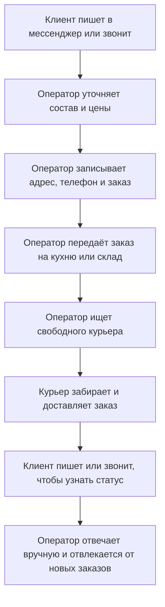
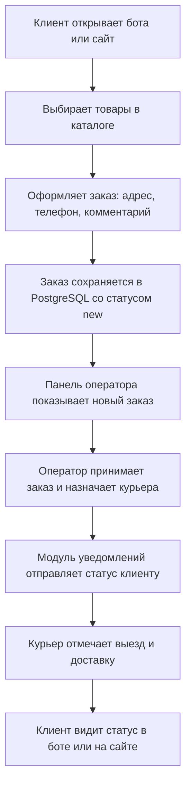

# Глава 1. Анализ предметной области и постановка задачи

## 1.1. Актуальность автоматизации приёма заказов

Службы доставки малого и среднего размера принимают заказы по телефону и в мессенджерах. Для клиента такой канал удобен: не нужно устанавливать приложение, достаточно написать сообщение или позвонить. Для бизнеса он создаёт нагрузку, которая растёт вместе с числом заказов и почти не поддаётся планированию.

Ручной приём заказа занимает у оператора несколько минут. За это время нужно выяснить состав заказа, проверить наличие позиций, уточнить адрес и телефон, назвать сумму, передать заказ на кухню или склад и найти свободного курьера. В пиковые часы оператор работает с несколькими диалогами одновременно, и часть сообщений остаётся без ответа дольше, чем клиент готов ждать. Ошибки в адресе или составе заказа обнаруживаются уже после передачи курьеру, а исправление требует повторных звонков.

Отдельная проблема связана с информацией о статусе. Клиент не видит, на каком этапе находится заказ, поэтому пишет или звонит повторно. Оператор отвечает на эти обращения вместо обработки новых заказов. Если оператор заболел или уволился, вместе с ним из процесса уходит знание о том, какие заказы приняты и кому они переданы.

Агрегаторы доставки закрывают часть этих проблем: они приводят клиентов, предоставляют приложение, курьеров и приём платежей. За это партнёр платит комиссию с каждого заказа. По данным Finratings, комиссия Wolt составляет около 20 %, Glovo и Яндекс Еды около 30 %; с учётом рекламы и дополнительных сборов предприниматели оценивают расходы в 35-50 % от стоимости заказа [1]. В интервью Forbes руководитель Wolt в Казахстане называл среднюю комиссию по отрасли на уровне 30 % [2]. Точная ставка зависит от договора, города и набора услуг [7], но порядок величины понятен.

Для малого бизнеса комиссия в 30 % сравнима с себестоимостью продуктов. При среднем чеке 5 000 тенге партнёр отдаёт 1 500 тенге с каждого заказа, а оставшаяся сумма должна покрыть продукты, упаковку, работу курьера и прибыль. Агрегатор при этом сохраняет у себя историю заказов и контакты клиентов, поэтому бизнес не может напрямую обратиться к своей аудитории, напомнить о себе или предложить повторный заказ без дополнительной рекламы.

Технические условия для собственного канала связи стали доступнее. Telegram предоставляет открытый Bot API и не берёт плату за сообщения ботов [3]. Библиотека aiogram упрощает асинхронную обработку сообщений на Python [4], Django даёт готовую панель управления с ролями и правами доступа [5], PostgreSQL подходит для хранения заказов и истории статусов [6]. Для запуска достаточно виртуального сервера, а разработку может выполнить небольшая команда.

Собственный Telegram-бот с веб-панелью оператора сохраняет комиссию внутри бизнеса и оставляет клиентскую базу у владельца. Клиент оформляет заказ в привычном мессенджере, оператор видит заказ в панели и меняет статус, а бот сообщает об изменениях. Задача автоматизации приёма и обработки заказов для службы доставки имеет практическое значение: она снижает нагрузку на оператора, уменьшает число ошибок и даёт бизнесу данные для управления.

## 1.2. Предметная область и участники процесса

Предметная область охватывает приём заказа, его подтверждение, передачу курьеру, доставку и информирование клиента. Границы процесса начинаются с выбора товара в каталоге и заканчиваются статусом "доставлен" или "отменён". Управление каталогом, назначение курьеров и отчётность относятся к вспомогательным процессам, без них основной процесс не работает.

Заказ проходит несколько состояний. Сначала клиент собирает корзину и указывает адрес, телефон и комментарий. После подтверждения заказ попадает в базу со статусом "новый". Оператор проверяет состав, принимает заказ и назначает курьера. Курьер сообщает о выезде и завершении доставки. На каждом переходе клиент получает уведомление, а в панели сохраняется, кто и когда изменил статус.

Участники процесса различаются целями, каналом связи и набором действий. В таблице 1.1 перечислены роли, которые учитываются при проектировании системы.

Таблица 1.1. Участники процесса доставки

| Роль | Канал | Основные действия | Результат |
|---|---|---|---|
| Клиент | Telegram-бот | Смотрит каталог, собирает корзину, оформляет заказ, следит за статусом, задаёт вопросы | Получает заказ и информацию о его состоянии |
| Оператор | Веб-панель | Принимает заказы, назначает курьеров, меняет статусы, правит каталог, отвечает на обращения | Заказ передан в доставку без ошибок |
| Курьер | Веб-панель, уведомления | Получает назначенные заказы, отмечает выезд и доставку | Заказ доставлен, статус обновлён |
| Руководитель | Веб-панель | Управляет пользователями и ролями, смотрит статистику | Решения по загрузке и выручке |
| Владелец бизнеса | Отчётность | Получает сводки по продажам и времени доставки | Контроль экономики |

В небольшой службе роли часто совмещаются. Оператор может одновременно отвечать за каталог и за назначение курьеров, а руководитель выполняет функции владельца. Система должна допускать такое совмещение, но не давать курьеру доступ к чужим заказам или к управлению пользователями. Разграничение прав входит в требования к панели.

Основные информационные объекты предметной области: товар, категория, заказ, позиция заказа, курьер, статус и уведомление. Товар описывает то, что можно заказать, и содержит цену и признак доступности. Заказ фиксирует клиента, адрес, телефон, источник и итоговую сумму. Позиция заказа хранит товар, количество и цену на момент оформления. Статус отражает текущее состояние заказа, а уведомление фиксирует факт отправки сообщения клиенту.

Из предметной области следуют четыре требования, которые влияют на архитектуру. Первое: заказ, созданный в боте или на сайте, должен сразу попадать в общую базу, иначе оператор увидит его с задержкой. Второе: цена позиции фиксируется при оформлении, потому что после изменения каталога история заказов не должна пересчитываться. Третье: переходы статусов нужно сохранять, чтобы разобрать спорную ситуацию и понять, кто изменил заказ. Четвёртое: доступ к действиям оператора и руководителя различается, поэтому панель не может быть общей страницей без авторизации.

## 1.3. Бизнес-процессы AS-IS и TO-BE

### 1.3.1. Процесс "как есть"

В текущем процессе заказ принимает оператор. Клиент пишет в WhatsApp или Telegram либо звонит. Оператор выясняет состав заказа, называет цены и уточняет адрес. Запись ведётся в блокнот, таблицу Excel или в историю переписки. Затем оператор передаёт заказ на кухню или склад, ищет свободного курьера и сообщает ему адрес. Статус заказа нигде не фиксируется, кроме переписки. Когда клиент спрашивает, где заказ, оператор прерывает текущую работу и ищет информацию.

На рисунке 1.1 показана последовательность шагов. Отдельной ветки для контроля статуса нет: клиент возвращается к оператору с тем же вопросом, с которого начал.

Рисунок 1.1. Процесс обработки заказа AS-IS

Слабые места процесса удобно сопоставить с шагами, на которых они возникают (таблица 1.2). Чем больше заказов одновременно, тем сильнее проявляется каждое из них.

Таблица 1.2. Проблемы процесса AS-IS

| Шаг | Действие | Проблема |
|---|---|---|
| 1 | Клиент пишет или звонит | Ожидание ответа в пиковые часы |
| 2 | Оператор уточняет состав | Ошибки в ценах и наличии, долгий диалог |
| 3 | Оператор записывает заказ | Потеря сообщений, разные форматы записи |
| 4 | Передача на кухню или склад | Заказ теряется между оператором и производством |
| 5 | Поиск курьера | Задержка, если свободного курьера нет |
| 6 | Доставка | Клиент не знает, где заказ |
| 7 | Повторный вопрос о статусе | Оператор отвлекается от новых заказов |

У процесса есть и организационная слабость. Знания о заказах хранятся у одного сотрудника и в разных каналах связи. Если оператор недоступен, заказы остаются без движения, а восстановить картину можно только по переписке. Отчётность собирается вручную и не даёт сравнить загрузку по дням или среднее время доставки.

### 1.3.2. Процесс "как будет"

В новом процессе клиент работает с ботом или сайтом. Каталог строится по категориям, цена и доступность берутся из базы. Клиент собирает корзину, указывает адрес и телефон, при необходимости добавляет комментарий и подтверждает заказ. Бот проверяет актуальность цен и доступность товаров, затем создаёт заказ одной транзакцией.

Заказ попадает в PostgreSQL со статусом "новый". Панель оператора получает его без обновления страницы и показывает уведомление. Оператор принимает заказ, назначает курьера и переводит заказ в статус "передан курьеру". Курьер отмечает выезд и завершение доставки. При каждом переходе модуль уведомлений отправляет сообщение в Telegram, если клиент связан с ботом, а в журнале сохраняется результат отправки.

На рисунке 1.2 показана последовательность шагов нового процесса. Бот, сайт и панель работают с одной базой, поэтому заказ не нужно переносить вручную.

Рисунок 1.2. Процесс обработки заказа TO-BE

Процессы различаются скоростью и местом хранения информации. В процессе AS-IS заказ существует в переписке и в записях оператора. В процессе TO-BE заказ существует в базе, а панель, бот и сайт только отображают его состояние.

### 1.3.3. Сравнение процессов

В таблице 1.3 процессы сопоставлены по критериям, которые важны для ежедневной работы службы доставки. Значения для процесса TO-BE указаны как проектные цели, а не как результат измерений: пилотный запуск ещё не проводился, и фактические показатели нужно снимать на работающей системе.

Таблица 1.3. Сравнение процессов AS-IS и TO-BE

| Критерий | AS-IS | TO-BE |
|---|---|---|
| Оформление заказа | Зависит от занятости оператора | Клиент проходит шаги самостоятельно |
| Фиксация заказа | Блокнот, Excel, переписка | Единая база PostgreSQL |
| Контроль статуса | Оператор отвечает вручную | Клиент получает уведомления и видит статус |
| Ошибки в адресе и составе | Обнаруживаются после передачи курьеру | Проверяются на шаге подтверждения |
| Загрузка оператора | Приём заказов и ответы на вопросы | Подтверждение, назначение курьера, спорные случаи |
| Данные для анализа | Собираются вручную | Хранятся в заказах и истории статусов |
| Зависимость от сотрудника | Высокая | Заказы и история доступны в системе |

Проектные цели нового процесса: заказ появляется в панели не позже чем через 2 секунды после подтверждения, ответ бота на действие клиента занимает не больше 2 секунд при нормальной нагрузке. Эти значения зафиксированы в нефункциональных требованиях и проверяются на приёмочных тестах.

## 1.4. Обзор существующих решений

На рынке есть три подхода к автоматизации приёма заказов: агрегаторы доставки, конструкторы чат-ботов и собственная разработка. Они решают разные задачи и подходят бизнесу с разным объёмом заказов.

### 1.4.1. Агрегаторы доставки

Агрегаторы Wolt, Glovo и Яндекс Еда объединяют рестораны и службы доставки в одном приложении. Клиент видит меню, оформляет заказ и оплачивает его на платформе. Агрегатор предоставляет курьеров, приложение, поддержку и продвижение. Партнёр получает поток заказов, но платит комиссию с каждого чека.

Сильная сторона агрегатора в том, что он приводит новых клиентов. Для заведения, которое только выходит на рынок, это быстрый способ получить заказы без собственной рекламы. Платформа берёт на себя маршрутизацию курьеров и приём оплаты, а партнёру не нужно строить IT-систему.

Ограничения начинаются с экономики. Комиссия 20-30 % от чека, а с учётом рекламы расходы доходят до 35-50 % [1]. Клиентская база принадлежит платформе: партнёр не получает контакты клиентов и не может отправить им рассылку. Правила продвижения, рейтинга и штрафов задаёт агрегатор, и партнёр не может их изменить. Бренд заведения в приложении теряется среди конкурентов, а заказ выглядит как заказ платформы, а не службы доставки.

Для малого бизнеса агрегатор полезен как дополнительный канал продаж. Как единственный канал он забирает часть маржи и не даёт построить прямые отношения с клиентом.

### 1.4.2. Конструкторы чат-ботов

В BotMan, Salebot и LeadConverter бот собирается без программирования. Сценарий рисуется в визуальном редакторе, шаги связываются кнопками и переходами. Готовые шаблоны закрывают приветствие, меню, сбор контактов и простые вопросы. Интеграции с внешними сервисами выполняются через webhook или готовые модули.

Конструктор подходит для быстрого запуска, когда нужно принимать заявки и отвечать на типовые вопросы. Подписка и лимиты на сообщения обходятся дешевле собственной разработки на старте. Запуск занимает дни.

Для службы доставки возможностей конструктора не хватает. Заказ состоит из позиций с количеством и ценой, корзина должна пересчитываться, а цены нужно сверять с базой перед подтверждением. Оператору нужна панель с фильтрами, статусами, ролями и статистикой, а не таблица сообщений. Сложную логику в конструкторе приходится собирать из ветвлений, и она становится хрупкой при каждом изменении меню. Синхронизация с собственной базой и с панелью остаётся отдельной задачей, которую конструктор не решает.

### 1.4.3. Собственная разработка

Собственная разработка предполагает, что команда создаёт бота, сайт и панель под конкретный процесс. В проекте Nurlight используется стек Python: aiogram 3 для бота, Django для панели и сайта, PostgreSQL для хранения данных. Компоненты работают с одной базой и общим модулем уведомлений.

Систему можно подстроить под процесс службы доставки: задать свои статусы, правила назначения курьеров, состав отчётов и тексты сообщений. Клиентская база и история заказов остаются у бизнеса, а комиссия не уходит третьей стороне. AI-агент, который отвечает на вопросы о меню и доставке, встраивается в тот же контур и берёт данные из базы.

Стоимость владения складывается из разработки, поддержки и хостинга. Нужна команда, которая обновляет зависимости, следит за безопасностью и исправляет ошибки. Для небольшой службы это существенные затраты, но при устойчивом потоке заказов они окупаются за счёт отказа от комиссии. Конкретный расчёт приведён в разделе 1.5.

## 1.5. Сравнительный анализ и выбор решения

Сравнение подходов выполнено по критериям, которые определяют экономику и удобство работы: комиссия, владение клиентской базой, порог входа, гибкость настройки, панель оператора и стоимость владения. В таблице 1.4 агрегаторы, конструкторы и собственная разработка сопоставлены по этим критериям.

Таблица 1.4. Сравнение подходов к автоматизации

| Критерий | Агрегаторы | Конструкторы ботов | Собственная разработка |
|---|---|---|---|
| Комиссия с заказа | 20-30 %, с рекламой до 35-50 % | Подписка и лимиты сообщений | 0 % комиссии, только хостинг |
| Клиентская база | Принадлежит платформе | Остаётся у бизнеса частично | Полностью у бизнеса |
| Порог входа | Низкий, нужен договор | Низкий, нужен сценарий | Средний, нужна команда |
| Гибкость логики | Правила платформы | Ограничена шаблонами | Настраивается под процесс |
| Панель оператора | Терминал агрегатора | Таблица сообщений | Полноценная панель с ролями |
| Стоимость владения | Растёт с каждым заказом | Подписка | Разработка, поддержка, хостинг |
| Зависимость | Высокая | Средняя | Низкая |

Комиссия сильнее всего влияет на экономику. Она начисляется с каждого заказа и растёт вместе с выручкой, поэтому при большом потоке абсолютная сумма становится значительной. Подписка конструктора не зависит от числа заказов, но ограничивает логику и требует отдельных доработок. Собственная разработка требует вложений на старте, зато дальнейшие расходы почти не зависят от объёма продаж.

Владение клиентской базой определяет возможность повторных продаж. Агрегатор не отдаёт контакты клиентов, поэтому бизнес платит за каждого нового клиента заново. Конструктор сохраняет часть данных, но не даёт полноценной истории заказов и статусов. Собственная система хранит клиентов, заказы и историю, поэтому владелец может строить рассылки и анализировать повторные покупки.

Порог входа и стоимость владения связаны с наличием команды. Конструктор запускается быстрее всего, агрегатор требует только договора. Собственная разработка занимает месяцы, но в учебном проекте команда уже имеет нужные навыки, а код остаётся в репозитории.

Для оценки экономического эффекта приняты следующие допущения: средний чек 5 000 тенге, комиссия агрегатора 25 %, расходы на собственный канал 20 000 тенге в месяц (виртуальный сервер, домен, резервное копирование). Расчёт не учитывает рекламу и другие расходы на привлечение клиентов; стоимость разработки задана условно.

При 100 заказах в месяц выручка составляет 500 000 тенге, комиссия агрегатора 125 000 тенге. Собственный канал обходится в 20 000 тенге, экономия достигает 105 000 тенге в месяц или 1 260 000 тенге в год. Если условная стоимость разработки равна 1 500 000 тенге, вложения окупаются примерно за 14 месяцев.

Таблица 1.5. Экономия при разном числе заказов

| Заказов в месяц | Выручка, тенге | Комиссия 25 %, тенге | Расходы на свой канал, тенге | Экономия в месяц, тенге | Окупаемость при 1,5 млн тенге, месяцев |
|---|---|---|---|---|---|
| 50 | 250 000 | 62 500 | 20 000 | 42 500 | 35 |
| 100 | 500 000 | 125 000 | 20 000 | 105 000 | 14 |
| 200 | 1 000 000 | 250 000 | 20 000 | 230 000 | 7 |

Расчёт показывает границу применимости. При 50 заказах в месяц экономия скромная, и конструктор или агрегатор могут оказаться выгоднее. При 100 заказах и выше собственный канал окупается, а с ростом потока разрыв увеличивается. Для службы доставки с потоком около ста заказов в месяц и выше разработка имеет смысл.

Есть и качественные выгоды, которые не входят в таблицу. Оператор перестаёт вручную переносить заказы, клиент получает статус без звонка, а руководитель видит статистику по выручке и времени доставки. Эти изменения сложно оценить в деньгах на старте, но они снижают число ошибок и освобождают время сотрудников.

## 1.6. Постановка задачи и границы MVP

Объект исследования: процессы приёма и обработки заказов службы доставки. Предмет исследования: средства автоматизации этих процессов, включая Telegram-бота, клиентский сайт, веб-панель оператора и AI-агента.

Цель работы: сократить время обработки заказа и операционные затраты службы доставки за счёт единой системы приёма заказов, которая сохраняет клиентскую базу у бизнеса и не требует комиссии агрегатора.

Задачи работы:
1. Проанализировать предметную область, текущий и целевой процессы, существующие решения и требования к системе.
2. Спроектировать архитектуру, модель данных, статусы заказа и контракты взаимодействия компонентов.
3. Разработать Telegram-бота, клиентский сайт и веб-панель оператора на общей базе данных.
4. Добавить AI-агента для ответов на вопросы о меню, доставке и статусе заказа.
5. Провести тестирование, проверить сценарии и оценить результат внедрения.

Состав системы приведён в таблице 1.6. Компоненты связаны через PostgreSQL и общий модуль уведомлений.

Таблица 1.6. Состав системы Nurlight

| Компонент | Пользователь | Основные функции |
|---|---|---|
| Telegram-бот | Клиент | Каталог, корзина, оформление заказа, мои заказы, FAQ, AI-консультант |
| Клиентский сайт | Клиент | Меню, корзина, оформление, проверка статуса по номеру и телефону |
| Веб-панель | Оператор, курьер, руководитель | Заказы, статусы, курьеры, каталог, обращения, статистика, роли |
| Модуль уведомлений | Система | Отправка сообщений при смене статуса, журнал ошибок |
| AI-агент | Клиент | Ответы по меню, ценам, доставке и статусу, передача оператору |
| PostgreSQL | Система | Единое хранилище заказов, товаров, клиентов и истории |

Границы MVP зафиксированы, чтобы команда не распыляла усилия до защиты. В таблице 1.7 перечислено, что входит в первую версию и что отложено.

Таблица 1.7. Границы MVP

| Входит в MVP | Не входит в MVP |
|---|---|
| Каталог, корзина, оформление заказа | Онлайн-оплата |
| Статусы заказа и уведомления клиенту | Мобильное приложение |
| Панель оператора с ролями | Геолокация и расчёт доставки по расстоянию |
| Управление каталогом и курьерами | Казахский язык |
| FAQ и AI-агент | Интеграция с бухгалтерией |
| Статистика для руководителя | Программа лояльности и рассылки |

Критерии готовности первой версии:
- клиент проходит путь от каталога до заказа в боте и на сайте, заказ появляется в панели;
- оператор принимает заказ, назначает курьера и доводит заказ до статуса "доставлен";
- клиент получает уведомление на каждом переходе статуса;
- AI-агент отвечает на проверочные вопросы, не выдумывает цены и предлагает оператора, если ответа нет в базе;
- руководитель видит статистику по заказам и выручке за период;
- пройдены тест-кейсы сценариев и автотесты панели, известных блокирующих ошибок нет.

## 1.7. Требования к системе

### 1.7.1. Функциональные требования

Функциональные требования сгруппированы по модулям. В таблице 1.8 приведены ключевые требования; полный реестр с идентификаторами и приоритетами хранится в документе `docs/requirements.md` проекта.

Таблица 1.8. Функциональные требования по модулям

| Модуль | Требования |
|---|---|
| Telegram-бот | Регистрация по /start и создание профиля клиента; главное меню; каталог по категориям; корзина с изменением количества; оформление заказа по шагам; проверка актуальности цен; подтверждение и создание заказа; мои заказы; отмена заказа в статусе "новый"; FAQ и связь с оператором |
| Клиентский сайт | Меню с категориями и ценами; корзина; оформление заказа; проверка статуса по номеру и телефону; отметка источника заказа; работа на телефоне; HTTPS |
| Веб-панель | Новые заказы в реальном времени; фильтры по статусу, дате и источнику; смена статусов; назначение курьера; управление каталогом; роли оператора, курьера и руководителя; статистика; история изменений |
| AI-агент | Ответы по меню, ценам, доставке и статусу; данные из базы; запрет на выдуманные товары и скидки; передача оператору при отсутствии ответа; единый API для бота и сайта |
| Уведомления | Сообщение клиенту при смене статуса; одно сообщение на переход; журнал отправок; обработка ошибок Telegram |

Требования к оформлению заказа учитывают типичные ошибки. Адрес принимается только текстом, содержит номер дома и проверяется по длине. Телефон можно отправить кнопкой или ввести вручную, после чего он приводится к формату +7XXXXXXXXXX. Комментарий необязателен и ограничен 500 символами. Перед созданием заказа бот показывает сводку с составом, суммой, адресом и телефоном, чтобы клиент проверил данные.

### 1.7.2. Нефункциональные требования

Нефункциональные требования определяют, как система должна работать под нагрузкой и какие ограничения действуют при разработке. Они приведены в таблице 1.9.

Таблица 1.9. Нефункциональные требования

| ID | Требование |
|---|---|
| NFR-01 | Бот работает асинхронно и не блокирует обработку сообщений запросами к базе |
| NFR-02 | Заказ появляется в панели не позже чем через 2 секунды после подтверждения |
| NFR-03 | Ответ бота на действие клиента занимает не больше 2 секунд при нормальной нагрузке |
| NFR-04 | Бот, сайт и панель работают с одной базой PostgreSQL без промежуточной синхронизации |
| NFR-05 | Пароли, токен бота и ключи API хранятся в переменных окружения и не попадают в репозиторий |
| NFR-06 | Доступ к панели открыт только после авторизации, права различаются по ролям |
| NFR-07 | Сайт и панель работают по HTTPS |
| NFR-08 | Резервное копирование базы выполняется не реже одного раза в сутки |
| NFR-09 | Ошибки бота и панели логируются, историю статусов заказа можно восстановить |
| NFR-10 | Интерфейс панели и сайта пригоден для работы с телефона и ноутбука |
| NFR-11 | Код покрыт автотестами: создание заказа, смена статуса, проверка прав |

### 1.7.3. Данные и статусы заказа

Статус заказа определяет, какие действия доступны клиенту и оператору. В таблице 1.10 перечислены статусы, роли, которые их устанавливают, и сообщения, которые видит клиент.

Таблица 1.10. Статусы заказа

| Статус | Кто устанавливает | Сообщение клиенту |
|---|---|---|
| new, новый | Бот или сайт при создании | Заказ принят, передан оператору |
| accepted, принят | Оператор | Оператор подтвердил заказ |
| assigned, передан курьеру | Оператор | Курьер назначен |
| in_transit, в пути | Курьер или оператор | Курьер выехал |
| delivered, доставлен | Курьер или оператор | Заказ доставлен |
| cancelled, отменён | Оператор; клиент только в статусе new | Заказ отменён |

Переходы ограничены, чтобы заказ не мог вернуться в предыдущее состояние или перескочить этап:
1. Из new заказ переходит в accepted или cancelled.
2. Из accepted заказ переходит в assigned или cancelled.
3. Из assigned заказ переходит в in_transit или cancelled.
4. Из in_transit заказ переходит только в delivered.
5. Из delivered и cancelled переходов нет.

К данным предъявляются отдельные требования. Цена позиции хранится в OrderItem, а не берётся из карточки товара при просмотре заказа. Итоговая сумма пересчитывается из позиций и не вводится вручную. Удаление товара не удаляет историю заказов: товар помечается недоступным или хранится ссылкой с запретом удаления. Служебные таблицы истории статусов, журнала уведомлений и обращений нужны для разбора спорных ситуаций.

Заказ с сайта без привязки к Telegram обрабатывается так же, как заказ из бота. Уведомления в Telegram для него не отправляются, статус клиент проверяет на сайте по номеру и телефону.

## 1.8. Выводы по главе

Анализ предметной области показал, что ручной приём заказов ограничивает рост службы доставки. Оператор тратит время на уточнения и повторные вопросы о статусе, заказы хранятся в разных каналах, а ошибки обнаруживаются после передачи курьеру. Агрегаторы снимают часть нагрузки, но забирают 20-30 % с каждого заказа и оставляют клиентскую базу у платформы. Конструкторы ботов подходят для простых заявок, но не дают единой базы, полноценной панели и сложной логики заказа.

Из сравнения подходов по комиссии, владению базой, гибкости и стоимости владения следует, что собственная разработка выгодна при устойчивом потоке от 100 заказов в месяц. Для меньшего объёма разумнее начать с готового канала и вернуться к разработке после роста. В учебном проекте команда уже обладает нужными навыками, поэтому разработка бота, сайта и панели на общей базе PostgreSQL выбрана как основное решение.

Сформулированы цель и задачи работы, состав системы, границы MVP, функциональные и нефункциональные требования, правила смены статусов и требования к данным. Эти результаты используются в главе 2, где проектируются архитектура системы, модель данных, контракты API и интерфейсы пользователей.

## Список источников к главе 1

1. Казахстанцам показали, сколько на самом деле забирают сервисы доставки Glovo, Wolt и Яндекс Еда // Finratings.kz. 04.08.2026. URL: https://finratings.kz/news/15890-kazakhstantsam-pokazali-skolko-na-samom-dele-zabiraiut-servisy-dostavki-glovo-wolt-i-iandeks-eda/ (дата обращения: 21.11.2026).
2. Wolt в Казахстане: как за год стать лидерами рынка доставки еды // Forbes Kazakhstan. 04.12.2020. URL: https://forbes.kz/articles/wolt_v_kazahstane_kak_za_god_stat_liderami_ryinka_dostavki_edyi_2 (дата обращения: 21.11.2026).
3. Telegram Bot API. URL: https://core.telegram.org/bots/api (дата обращения: 21.11.2026).
4. aiogram 3 documentation. URL: https://docs.aiogram.dev/en/latest/ (дата обращения: 21.11.2026).
5. Django documentation. URL: https://docs.djangoproject.com/en/stable/ (дата обращения: 21.11.2026).
6. PostgreSQL documentation. URL: https://www.postgresql.org/docs/ (дата обращения: 21.11.2026).
7. Комиссии и тарифы для партнёров Wolt // Wolt Казахстан. URL: https://merchant.wolt.com/ru-kz/kaz/learning-center/wolt-merchant-fees-and-commissions (дата обращения: 21.11.2026).
