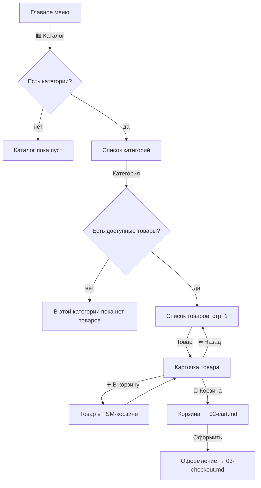

# Сценарий «Каталог и карточка товара»

| | |
|---|---|
| Версия | 1.0 |
| Дата | 18.11.2026 |
| Автор | Ислам (студент 1, аналитик / тимлид) |
| Статус | Черновик, на согласовании с командой |
| Реализует | Нурадыл — бот; Нурдаулет — сайт |
| Связанные сценарии | `02-cart.md`, `03-checkout.md`, `06-faq.md` |
| Требования | FR-BOT-02, FR-BOT-03, FR-BOT-05, FR-BOT-22, FR-BOT-23, FR-WEB-01, FR-WEB-06, FR-WEB-07 |
| Затрагивает главу | Глава 1 (TO-BE), Глава 2 (реализация каталога) |

---

## 1. Назначение и границы

**Назначение.** Описать, как клиент попадает в каталог, выбирает категорию и товар и добавляет его в корзину — в Telegram-боте и на сайте. Это первый шаг основного пути «каталог → корзина → оформление → заказ».

**Входит в сценарий:**

- главное меню бота и навигация в каталоге;
- список категорий;
- список товаров категории с ценой и доступностью;
- карточка товара с описанием и ценой;
- добавление товара в корзину из карточки;
- те же шаги на сайте (меню, сетка товаров, карточка, кнопка «В корзину»);
- поведение при пустом каталоге и при товаре, который стал недоступен.

**Не входит (отдельные сценарии):**

- изменение количества и удаление позиций — `02-cart.md`;
- оформление заказа — `03-checkout.md`;
- вопросы о меню и доставке в свободной форме — `06-faq.md` (AI-консультант);
- управление каталогом оператором — `07-operator.md`.

**Главное правило.** Каталог в боте и на сайте читает одни и те же таблицы `Category` и `Product`. Цена и доступность нигде не дублируются в коде — только в базе (FR-WEB-03, NFR-04).

---

## 2. Участники и предусловия

| Роль | Что делает в этом сценарии |
|---|---|
| Клиент | Открывает каталог, листает категории, открывает карточку, добавляет товар |
| Бот (aiogram 3) | Показывает категории и товары, проверяет доступность, пишет в FSM-корзину |
| Сайт (Django) | Показывает меню и карточки, добавляет товар в корзину |
| База (PostgreSQL) | Хранит `Category`, `Product`, цены и `is_available` |
| Панель | Меняет цены и доступность; каталог клиента обновляется при следующем запросе |

**Предусловия:**

1. Клиент запустил бота по `/start` — создана запись `Client`.
2. В базе есть хотя бы одна категория с доступными товарами.
3. Бот и сайт работают с одной базой.

**Постусловия (успех):** товар добавлен в корзину, счётчик и сумма корзины пересчитаны, клиент остаётся в каталоге и может продолжить выбор.

---

## 3. Принятые решения

| № | Вопрос | Решение в MVP | Обоснование |
|---|---|---|---|
| 1 | Откуда берутся данные | Только из `Category` и `Product`, без хардкода и без файлов с меню | Иначе правка цены в панели не доедет до клиента (FR-WEB-03, NFR-04) |
| 2 | Недоступный товар | В боте **не показывается**; на сайте **показывается серым** с подписью «Нет в наличии» без кнопки добавления | В боте скрытие экономит место и убирает лишние тапы (FR-BOT-05). На сайте пустая дыра в сетке выглядит как ошибка, а серую карточку видно как «всё в порядке, товар есть в меню» |
| 3 | Кэширование | Бот читает базу при каждом запросе; сайт кэширует страницу меню на 30 секунд и сбрасывает кэш при сохранении товара в панели | NFR-02: цена не должна отставать, но и лишние запросы на каждый заход не нужны |
| 4 | Пагинация в боте | 6 товаров на страницу, кнопки «⬅️», «стр. N из M», «➡️» | Ограничение Telegram на размер inline-клавиатуры и читаемость |
| 5 | Сортировка | `Category.sort_order`, затем `Product.sort_order`, затем название | Порядок задаёт оператор, а не алфавит |
| 6 | Длина описания в боте | До 700 символов, обрезка по границе слова и «…» | Лимит подписи к фото в Telegram — 1024 символа; 700 оставляет место заголовку и цене. На сайте описание показывается полностью |
| 7 | Изображения | `Product.image` — внешний URL; если пусто, карточка без фото | Не тратим место на file_id и не привязываемся к одному боту |
| 8 | Формат цены | Единая функция `format_money()`: `2 900 ₸` | Корзина и сводка не должны выглядеть по-разному (см. `03-checkout.md`, п. 8.5) |
| 9 | Резервирование товара | Корзина **не резервирует** товар | Резерв требует срока жизни и фоновой очистки — вне MVP; доступность проверяется при оформлении |
| 10 | «Назад» в боте | Возвращает в список той же категории и на ту же страницу | Клиент не теряет место, где остановился |

**Кнопка «🛍 Каталог» в главном меню — единственная точка входа.** Ссылки «в каталог» из пустой корзины и пустых «Моих заказов» ведут туда же.

---

## 4. Общая схема шагов



**Соответствие состояниям FSM.** Каталог работает на inline-callback'ах и **не переводит** клиента в отдельное состояние — иначе любое текстовое сообщение в каталоге пришлось бы трактовать как команду. FSM-состояния начинаются только в оформлении заказа (`OrderForm.*`). Корзина хранится в FSM-данных (`cart`) и доступна из любого состояния.

---

## 5. Детальные шаги бота

### Шаг 1. Главное меню

| | |
|---|---|
| **Триггер** | `/start`, `/menu`, кнопка «⬅️ В меню» |
| **Текст** | `👋 Здравствуйте, {имя}! Что хотите заказать?` |
| **Клавиатура** | Reply-клавиатура 2×2: «🛍 Каталог», «🛒 Корзина», «📦 Мои заказы», «❓ Помощь» |

### Шаг 2. Список категорий

| Клиент делает | Бот отвечает | Кнопки |
|---|---|---|
| Нажимает «🛍 Каталог» | `🛍 Каталог` + список категорий с числом доступных товаров | По одной категории в ряд: «🍕 Пицца (8)», «🥤 Напитки (5)»; ниже «🛒 Корзина» |
| Категорий нет | `Каталог пока пуст. Мы уже наполняем его — загляните позже.` | «⬅️ В меню» |

Правила:

- категория без доступных товаров **не показывается**: клиент не должен попадать в пустой раздел;
- счётчик в скобках — число доступных товаров, а не общее;
- больше 12 категорий — вторая страница «➡️ Ещё категории» (в MVP маловероятно, но обработчик должен не падать).

### Шаг 3. Список товаров категории

| Клиент делает | Бот отвечает | Кнопки |
|---|---|---|
| Выбирает категорию | `🍕 Пицца` + список «Название — 2 900 ₸» по 6 на страницу | По товару в ряд; ниже «⬅️» «стр. 1 из 2» «➡️», «⬅️ Категории», «🛒 Корзина» |
| Листает страницу | Тот же список, другая страница | То же |
| Нажимает на товар | Карточка товара | См. шаг 4 |

Правила:

- в списке видны только доступные товары;
- цена — актуальная из базы на момент запроса;
- если товаров в категории не осталось, показывается `В этой категории пока нет товаров. Загляните в другие разделы.` и кнопка «⬅️ Категории»;
- название в кнопке обрезается до 40 символов, чтобы кнопка не ломала вёрстку; полное название — в карточке.

### Шаг 4. Карточка товара

**Текст бота:**

```
🍕 Маргарита
2 900 ₸

Томатный соус, моцарелла, базилик.
25 см, 480 г.

В корзине: 0
```

| Клиент делает | Бот отвечает | Кнопки |
|---|---|---|
| Открывает товар | Карточка с описанием, ценой и текущим количеством в корзине | «➕ В корзину», «🛒 Корзина», «⬅️ К списку» |
| Нажимает «➕ В корзину» | Товар добавлен, всплывает «Добавлено: Маргарита × 1», количество в карточке обновляется | «➕ Ещё», «➖», «🛒 Корзина», «⬅️ К списку» |
| Нажимает «➖» при количестве 0 | Ничего не меняется | «➕ В корзину», «🛒 Корзина», «⬅️ К списку» |
| Нажимает «➖» при количестве 1 | Позиция удаляется, всплывает «Маргарита убрана из корзины» | Как при количестве 0 |
| Нажимает «🛒 Корзина» | Открывается корзина (`02-cart.md`) | — |

Правила:

- «➕» на карточке **не** открывает корзину и **не** создаёт отдельное сообщение — карточка редактируется на месте, чтобы не засорять чат;
- при количестве 99 кнопка «➕» отвечает всплывающим «Максимум 99 штук одной позиции»;
- если товар стал недоступен между списком и карточкой: «Этот товар закончился. Покажем, что ещё есть.», возврат в список категории;
- если товар удалён: то же сообщение;
- описание экранируется через `html.escape()` (FR-BOT-22), даже если его заполняет оператор.

### Шаг 5. Сайт

| Шаг | Что видит клиент | Поведение |
|---|---|---|
| Открывает сайт | Главная с меню и категориями | Категории — якоря или отдельные страницы `/menu/<slug>` |
| Смотрит сетку | Карточки: фото, название, цена, «В корзину» | Недоступные — серые, подпись «Нет в наличии», кнопки нет |
| Открывает карточку | Полное описание, состав, цена, кнопка «В корзину» | Кнопка добавляет товар и показывает уведомление, не уводя со страницы |
| Добавляет товар | Счётчик в шапке увеличивается | Корзина на сайте описана в `02-cart.md` |
| Заходит с телефона | Та же сетка в одну колонку | Ширина от 360 px, кнопки не меньше 44 px (FR-WEB-07) |

Ссылка на бота — в шапке и подвале сайта: «Заказать в Telegram» (FR-WEB-06).

---

## 6. Полный список текстов бота

Все тексты — HTML, пользовательские данные экранируются.

| Код | Текст |
|---|---|
| `MAIN_MENU` | 👋 Здравствуйте, {имя}! Что хотите заказать? |
| `CATALOG_TITLE` | 🛍 Каталог |
| `CATALOG_EMPTY` | Каталог пока пуст. Мы уже наполняем его — загляните позже. |
| `CATEGORY_EMPTY` | В этой категории пока нет товаров. Загляните в другие разделы. |
| `PRODUCT_CARD` | {эмодзи} {название}\n{цена}\n\n{описание}\n\nВ корзине: {количество} |
| `PRODUCT_ADDED` | Добавлено: {название} × {количество} |
| `PRODUCT_SOLD_OUT` | Этот товар закончился. Покажем, что ещё есть. |
| `PRODUCT_LIMIT` | Максимум 99 штук одной позиции. |
| `CATALOG_STALE` | Каталог обновился. Откройте его заново кнопкой «🛍 Каталог». |
| `PAGE_LABEL` | стр. {номер} из {всего} |

---

## 7. Обработка исключительных ситуаций

| Ситуация | Когда возникает | Поведение |
|---|---|---|
| Каталог пуст | Нет ни одной доступной категории | Сообщение `CATALOG_EMPTY`, кнопка «⬅️ В меню» |
| Категория опустела | Все товары скрыли в панели | Сообщение `CATEGORY_EMPTY`, кнопка «⬅️ Категории» |
| Товар стал недоступен | Между списком и карточкой или при добавлении | `PRODUCT_SOLD_OUT`, карточка не открывается, список перерисовывается |
| Товар удалён | Между списком и карточкой | То же, что и для недоступного |
| Цена изменилась | Пока клиент смотрел список | Показывается новая цена; в корзине — отдельное предупреждение (`02-cart.md`) |
| Двойной тап «➕» | Быстрые нажатия | Количество увеличивается на число нажатий, но не больше 99; второй callback не создаёт дубль позиции |
| Устаревшая клавиатура | Клиент нажал кнопку в старом сообщении | Бот отвечает всплывающим `CATALOG_STALE`, каталог перерисовывается в новом сообщении |
| Ошибка базы | Запрос списка упал | «Не удалось загрузить каталог. Попробуйте ещё раз.» + «🔁 Повторить», ошибка в лог |
| Сайт: JS отключён | Клиент без JS | Кнопка «В корзину» работает как обычная форма `POST`, корзина обновляется перезагрузкой страницы |

---

## 8. Требования к реализации

### 8.1. Файлы

| Файл | Содержимое |
|---|---|
| `bot/handlers/catalog.py` | Роутер каталога: категории, список, карточка, добавление |
| `bot/keyboards/catalog.py` | Инline-клавиатуры, `CatalogCallback` |
| `bot/services/catalog.py` | `get_categories()`, `get_products(category_id, page)`, `get_product(product_id)` |
| `site/menu/views.py`, `site/templates/menu/*.html` | Страницы меню и карточки на сайте |

### 8.2. Callback-данные

```python
class CatalogCallback(CallbackData, prefix="cat"):
    action: str            # categories, category, product, page, add, back
    category_id: int | None = None
    product_id: int | None = None
    page: int = 0
```

Ограничение Telegram — 64 байта на `callback_data`: передаём только id и номер страницы, никогда не название товара.

### 8.3. Запросы

```python
# Категории с числом доступных товаров
Category.objects.annotate(
    available_count=Count("products", filter=Q(products__is_available=True))
).filter(available_count__gt=0).order_by("sort_order", "name")

# Товары страницы
Product.objects.filter(category_id=category_id, is_available=True) \
    .order_by("sort_order", "name")[page * 6:(page + 1) * 6]
```

Требования:

1. Никаких N+1: категории и товары берутся одним запросом с `annotate`/`select_related`.
2. Время ответа на список — не дольше 2 секунд при нормальной нагрузке (NFR-03).
3. Счётчик «В корзине» берётся из FSM-данных, а не из базы.
4. Добавление в корзину — идемпотентная операция: повторный callback увеличивает количество, но не создаёт вторую позицию.

---

## 9. Критерии приёмки

| № | Проверка | Ожидаемый результат |
|---|---|---|
| 1 | `/start` → «🛍 Каталог» | Видны категории с числом доступных товаров |
| 2 | Категория с 8 товарами | 6 на первой странице, переход на вторую работает |
| 3 | Карточка товара | Название, описание, цена `2 900 ₸`, количество в корзине |
| 4 | «➕ В корзину» три раза | В корзине 3 шт., всплывающее уведомление, чат не засоряется |
| 5 | Товар скрыли в панели, клиент открывает карточку | Товар не показывается, возврат в список |
| 6 | Категория без доступных товаров | Категория не видна в списке |
| 7 | Последний товар категории скрыли | Сообщение `CATEGORY_EMPTY` |
| 8 | Сайт: товар «Нет в наличии» | Карточка серая, кнопки «В корзину» нет |
| 9 | Сайт на телефоне 360 px | Нет горизонтальной прокрутки, кнопки нажимаются |
| 10 | Правка цены в панели | Новая цена видна в боте и на сайте не позже 30 секунд |
| 11 | Описание 1000 символов | В боте обрезано до 700 с «…», на сайте полностью |
| 12 | Товар с названием `<b>тест</b>` | HTML экранирован, теги не выполняются |

---

## 10. Открытые вопросы

| № | Вопрос | Кого касается | Влияние |
|---|---|---|---|
| 1 | Нужны ли фото товаров в боте в MVP | Нурадыл, Нурдаулет | Без фото карточка короче и быстрее; с фото — понятнее |
| 2 | Показывать ли в боте категории без товаров (например, «Скоро») | Ислам, Нурадыл | Сейчас скрыты; если нужно — меняется запрос категорий |
| 3 | Нужен ли поиск по каталогу | все | В MVP нет; на сайте можно добавить строку поиска без изменения бота |
