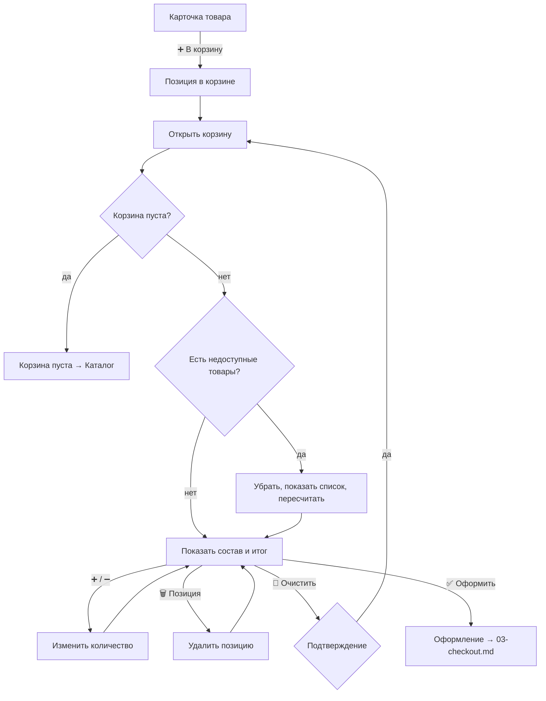

# Сценарий «Корзина»

| | |
|---|---|
| Версия | 1.0 |
| Дата | 18.11.2026 |
| Автор | Ислам (студент 1, аналитик / тимлид) |
| Статус | Черновик, на согласовании с командой |
| Реализует | Нурадыл — бот; Нурдаулет — сайт |
| Связанные сценарии | `01-catalog.md`, `03-checkout.md`, `04-my-orders.md` |
| Требования | FR-BOT-04, FR-BOT-05, FR-BOT-16, FR-BOT-17, FR-BOT-23, FR-WEB-02, FR-WEB-03 |
| Затрагивает главу | Глава 1 (TO-BE), Глава 2 (реализация корзины) |

---

## 1. Назначение и границы

**Назначение.** Описать, как клиент собирает корзину, меняет количество, удаляет позиции и переходит к оформлению — в боте и на сайте. Корзина — это «черновик заказа»: она живёт до подтверждения и не создаёт записей в `Order`.

**Входит в сценарий:**

- добавление товара в корзину (точка входа — `01-catalog.md`);
- просмотр корзины с составом, ценами и итогом;
- изменение количества и удаление позиции;
- полная очистка корзины;
- предупреждения о недоступных товарах и изменившихся ценах;
- переход к оформлению заказа;
- корзина на сайте (гостевая, без входа).

**Не входит (отдельные сценарии):**

- каталог и карточка товара — `01-catalog.md`;
- адрес, телефон, комментарий, подтверждение — `03-checkout.md`;
- статусы и отмена уже созданного заказа — `04-my-orders.md`;
- промокоды, скидки, бонусы — вне MVP.

**Ключевое правило.** Корзина показывает только доступные товары и всегда пересчитывает сумму из актуальных цен базы. Сумма в корзине и сумма в заказе не могут расходиться молча — любое изменение показывается клиенту.

---

## 2. Участники и предусловия

| Роль | Что делает в этом сценарии |
|---|---|
| Клиент | Добавляет товары, меняет количество, удаляет, очищает корзину |
| Бот (aiogram 3) | Хранит корзину в FSM-данных, пересчитывает итог, предупреждает об изменениях |
| Сайт (Django) | Хранит корзину в сессии, пересчитывает итог на сервере |
| База (PostgreSQL) | Источник цен и доступности |
| Оператор | Меняет цены и доступность; корзина реагирует при следующем открытии |

**Предусловия:**

1. Клиент зарегистрирован в боте (`/start`) или открыл сайт.
2. В каталоге есть доступные товары.

**Постусловия (успех):** корзина содержит выбранные позиции с количеством, итог пересчитан, клиент может открыть её в любой момент.

**Постусловия (после заказа):** корзина очищена только после успешного создания заказа. При отмене оформления корзина сохраняется.

---

## 3. Принятые решения

| № | Вопрос | Решение в MVP | Обоснование |
|---|---|---|---|
| 1 | Где хранится корзина в боте | В FSM-данных: `cart: dict[int, int]` — `{product_id: quantity}` | Не требует таблицы и миграции; корзина живёт один диалог. Цена в FSM **не** хранится — только количество |
| 2 | Где хранится корзина на сайте | Серверная сессия Django + зеркало в `localStorage` для гостя | Гость не обязан регистрироваться; сервер остаётся источником правды при оформлении |
| 3 | Лимит на позицию | От 1 до 99 штук | Защита от случайного «999» и от переполнения вёрстки |
| 4 | Лимит позиций | До 50 разных товаров | Больше в реальном заказе не бывает; защита от мусора |
| 5 | «➖» при количестве 1 | Удаляет позицию, всплывает «{товар} убран из корзины» | Одна кнопка вместо двух; удаление всегда можно отменить повторным добавлением |
| 6 | Очистка корзины | Только через подтверждение | Массовое действие нельзя делать одним случайным тапом |
| 7 | Изменилась цена | В корзине показывается строка «Цена изменилась: было → стало»; в заказ пишется новая цена | Клиент не должен узнать о подорожании только в сводке (FR-BOT-16, FR-BOT-17) |
| 8 | Товар стал недоступен | Убирается из корзины при открытии, показывается список убранного | Скрывать молча нельзя: сумма «прыгнет» без объяснения |
| 9 | Корзина резервирует товар | Нет | Резерв требует таймера и фоновой очистки — вне MVP |
| 10 | Формат сумм | `format_money()`: `2 900 ₸`, итог пересчитывается на сервере | Один формат в корзине и в сводке заказа (FR-BOT-23) |
| 11 | Корзина после `/start` | Сохраняется | `/start` — это навигация, а не отказ от товаров (см. `03-checkout.md`, п. 3.6) |

**Корзина не является заказом.** Пока клиент не нажал «✅ Подтвердить», в базе нет ни `Order`, ни `OrderItem`, а значит, нет и уведомлений оператору.

---

## 4. Общая схема шагов



**Соответствие состояниям FSM.** Корзина не имеет собственного состояния: она доступна из главного меню и из каталога. Внутри корзины бот работает на inline-callback'ах. FSM-данные `cart` читаются и в оформлении заказа (`OrderForm.*`), поэтому корзина не теряется при переходе между шагами.

---

## 5. Детальные шаги бота

### Шаг 1. Добавление товара

| Триггер | Что происходит |
|---|---|
| `CatalogCallback(action="add")` из карточки | Проверка доступности → проверка лимитов → `cart[product_id] += 1` → перерисовка карточки |
| Повторное добавление | Количество растёт, вторая позиция не создаётся |
| Товар недоступен | Всплывающее «Этот товар закончился», карточка закрывается, возврат в список |

### Шаг 2. Просмотр корзины

**Текст бота:**

```
🛒 Корзина

• Маргарита — 2 × 2 900 = 5 800 ₸
• Кола 0,5 — 1 × 450 = 450 ₸

Товары: 6 250 ₸
Доставка: бесплатно
Итого: 6 250 ₸
```

| Клиент делает | Бот отвечает | Кнопки |
|---|---|---|
| Нажимает «🛒 Корзина» | Состав, итог, кнопка оформления | По каждой позиции: «➖», «Маргарита × 2», «➕»; ниже «🗑 Убрать «Маргариту»»; «🧹 Очистить», «✅ Оформить заказ», «🛍 Каталог» |
| В корзине есть недоступный товар | Сначала строка «⚠️ Убрали из корзины: Чизкейк», затем состав без него | Кнопки как обычно |
| Корзина пуста | `Корзина пуста. Загляните в каталог 🛍` | «🛍 Каталог» |

Правила:

- итог считается на сервере при каждом открытии: `sum(price × qty)` по доступным товарам;
- строка «Доставка: бесплатно» показывается всегда, даже когда корзина почти пустая (см. `03-checkout.md`, п. 3.5);
- позиции сортируются по порядку добавления, а не по алфавиту: клиент помнит, что добавил;
- название позиции в кнопке обрезается до 30 символов, полное — в тексте.

### Шаг 3. Изменение количества

| Действие | Результат | Ограничение |
|---|---|---|
| «➕» | Количество +1, сумма пересчитана | На 99 — всплывающее «Максимум 99 штук одной позиции» |
| «➖» | Количество −1 | При 1 — позиция удаляется, всплывающее «Маргарита убран из корзины» |
| Быстрые нажатия | Каждый callback обрабатывается отдельно, потерь нет | Два параллельных callback'а не должны затирать друг друга (атомарное чтение-изменение FSM-данных) |

Бот **редактирует сообщение корзины на месте**, а не присылает новое. Если состав не изменился (например, нажали «➖» при нуле в карточке), бот отвечает всплывающим, а не ловит ошибку Telegram «message is not modified».

### Шаг 4. Удаление позиции и очистка

| Действие | Подтверждение | Результат |
|---|---|---|
| «🗑 Убрать «Маргариту»» | Нет | Позиция удалена, корзина перерисована, всплывающее «Убрали» |
| «🧹 Очистить корзину» | Да: «Очистить корзину? В ней 3 позиции на 6 250 ₸.» | «Очистить» → пустая корзина; «⬅️ Оставить» → возврат к корзине |

После очистки клиент остаётся в корзине (пустой), а не выбрасывается в меню: так понятнее, что произошло.

### Шаг 5. Переход к оформлению

| Действие | Что происходит |
|---|---|
| «✅ Оформить заказ» | Передача управления в `03-checkout.md`, шаг 0: проверка пустоты, повторная сверка доступности и цен |
| Пустая корзина | Кнопка не показывается; если callback всё же пришёл — сообщение «Корзина пуста» и «🛍 Каталог» |

### Шаг 6. Корзина на сайте

| Шаг | Что видит клиент | Поведение |
|---|---|---|
| Добавляет товар | Счётчик в шапке, всплывающее «Добавлено» | `POST /cart/add` → редирект назад или JSON для JS |
| Открывает `/cart` | Таблица: товар, цена, количество, сумма; итог и «Доставка: бесплатно» | Изменение количества — `POST /cart/update`, удаление — `POST /cart/remove` |
| Очищает | Кнопка «Очистить корзину» с подтверждением | `POST /cart/clear` |
| Переходит к оформлению | Форма оформления (`03-checkout.md`) | `GET /checkout`, корзина проверяется на сервере |
| Возвращается позже | Корзина сохранилась (сессия/`localStorage`) | Срок жизни — 30 дней |

Правила сайта:

- все изменения корзины — только `POST` с CSRF-токеном; `GET` ничего не меняет;
- сервер не доверяет количеству из формы: 0 → удалить, больше 99 → 99, отрицательное → ошибка;
- сумма пересчитывается на сервере, цена из `localStorage` игнорируется;
- если товар стал недоступен, при открытии корзины он помечается «Нет в наличии» и не входит в итог, с кнопкой «Убрать».

---

## 6. Полный список текстов бота

| Код | Текст |
|---|---|
| `CART_TITLE` | 🛒 Корзина |
| `CART_ITEM` | • {название} — {кол-во} × {цена} = {сумма} ₸ |
| `CART_TOTALS` | Товары: {сумма} ₸\nДоставка: бесплатно\nИтого: {сумма} ₸ |
| `CART_EMPTY` | Корзина пуста. Загляните в каталог 🛍 |
| `CART_UNAVAILABLE` | ⚠️ Убрали из корзины: {список} |
| `CART_PRICE_CHANGED` | ⚠️ Цена на {товар} изменилась: {было} → {стало} ₸. В заказ попадёт новая цена. |
| `CART_ADDED` | Добавлено: {название} × {кол-во} |
| `CART_REMOVED` | {название} убран из корзины. |
| `CART_ITEM_LIMIT` | Максимум 99 штук одной позиции. |
| `CART_SIZE_LIMIT` | В корзине уже 50 позиций. Оформите заказ или очистите корзину. |
| `CART_CLEAR_CONFIRM` | Очистить корзину? В ней {позиций} на {сумма} ₸. |
| `CART_CLEARED` | Корзина очищена. |
| `CART_STALE` | Корзина устарела — соберите её заново. |

---

## 7. Обработка исключительных ситуаций

| Ситуация | Когда возникает | Поведение |
|---|---|---|
| Пустая корзина | Открытие корзины без товаров | `CART_EMPTY` + «🛍 Каталог» |
| Товар стал недоступен | Между добавлением и открытием корзины | Убирается, показывается `CART_UNAVAILABLE`, итог пересчитан |
| Все товары недоступны | То же | Пустая корзина + сообщение, что товары закончились |
| Цена выросла | Между добавлением и открытием | `CART_PRICE_CHANGED`, в итоге новая цена |
| Цена упала | То же | Та же строка с новой ценой (клиенту приятно, молчать не нужно) |
| Достигнут лимит 99 | «➕» на 99 | Всплывающее, количество не меняется |
| Достигнут лимит 50 позиций | Добавление 51-го товара | `CART_SIZE_LIMIT`, товар не добавляется |
| Двойной тап «Оформить» | Быстрые нажатия | Второй callback перехватывается состоянием `OrderForm` (`03-checkout.md`, п. 5, шаг 5) |
| Потеря FSM-данных | Перезапуск бота, `/start` с очисткой | `CART_STALE`, корзина пуста; на сайте — корзина из сессии жива |
| Товар удалён из базы | Между добавлением и открытием | Считается недоступным: убирается с сообщением |
| Ошибка базы при пересчёте | Запрос упал | «Не удалось открыть корзину. Попробуйте ещё раз.» + «🔁 Повторить» |

---

## 8. Требования к реализации

### 8.1. Файлы

| Файл | Содержимое |
|---|---|
| `bot/handlers/cart.py` | Роутер корзины: показ, изменение, удаление, очистка, вход в оформление |
| `bot/keyboards/cart.py` | Inline-клавиатуры, `CartCallback` |
| `bot/services/cart.py` | `get_cart_items()`, `add_item()`, `set_quantity()`, `remove_item()`, `clear_cart()`, `cart_total()` |
| `site/cart/views.py`, `site/cart/services.py` | Корзина сайта, серверный пересчёт |
| `bot/utils/money.py` | `format_money()` — общая функция для корзины, сводки и заказов |

### 8.2. Callback-данные

```python
class CartCallback(CallbackData, prefix="cart"):
    action: str                 # open, inc, dec, remove, clear, clear_confirm, checkout, back
    product_id: int | None = None
```

### 8.3. Контракт сервиса корзины

```python
@dataclass
class CartView:
    items: list[CartItem]        # только доступные товары
    removed: list[str]           # названия убранных недоступных
    changed: list[PriceChange]   # изменившиеся цены
    subtotal: Decimal
    delivery: Decimal            # 0 в MVP
    total: Decimal

def get_cart_view(cart: dict[int, int]) -> CartView: ...
```

Требования:

1. `get_cart_view()` — единственная точка, где считается итог; шаблон текста не считает деньги.
2. `get_cart_view()` не меняет FSM-данные; очистка недоступных позиций выполняется отдельной функцией `sync_cart(cart) -> (cart, removed)`.
3. Суммы — `Decimal`, не `float`.
4. Повторный `add_item` не создаёт дубль позиции.
5. Корзина на сайте и в боте использует один и тот же формат денег и одинаковые тексты-шаблоны (различия только в разметке).

---

## 9. Критерии приёмки

| № | Проверка | Ожидаемый результат |
|---|---|---|
| 1 | Добавить 3 разных товара | В корзине 3 позиции, итог равен сумме |
| 2 | «➕» пять раз на одной позиции | 5 шт., сумма пересчитана |
| 3 | «➖» до 1 и ещё раз | Позиция удалена, всплывающее уведомление |
| 4 | «Очистить корзину» → «Оставить» | Корзина не изменилась |
| 5 | «Очистить корзину» → «Очистить» | Пустая корзина, сообщение |
| 6 | Товар скрыли в панели, открыть корзину | Товар убран, список убранного показан, итог пересчитан |
| 7 | Цену подняли с 2 900 до 3 200 | Строка «Цена изменилась», итог с новой ценой, в заказе 3 200 |
| 8 | 100-е нажатие «➕» | Количество 99, всплывающее о лимите |
| 9 | «Оформить заказ» | Переход к шагу адреса, корзина не потеряна |
| 10 | Отмена оформления | Корзина сохранена, позиции на месте |
| 11 | Успешный заказ | Корзина пуста, в «Моих заказах» новый заказ |
| 12 | Сайт: изменить количество на 0 | Позиция удалена, итог пересчитан |
| 13 | Сайт: подменить цену в `localStorage` | Итог не изменился — считается на сервере |
| 14 | Сайт: два таба с одной корзиной | Изменения не теряются, последнее состояние на сервере |
| 15 | `/start` во время заполненной корзины | Корзина сохранена |

---

## 10. Открытые вопросы

| № | Вопрос | Кого касается | Влияние |
|---|---|---|---|
| 1 | Нужна ли кнопка «↩️ Вернуть» после удаления позиции | Нурадыл, Ислам | Удобство против лишней кнопки; на реализацию заказа не влияет |
| 2 | Хранить ли корзину гостя на сайте дольше 30 дней | Нурдаулет | Только настройка срока жизни сессии |
| 3 | Показывать ли на сайте рекомендованные товары в корзине | Нурдаулет | Дополнительный блок, не требование MVP |
