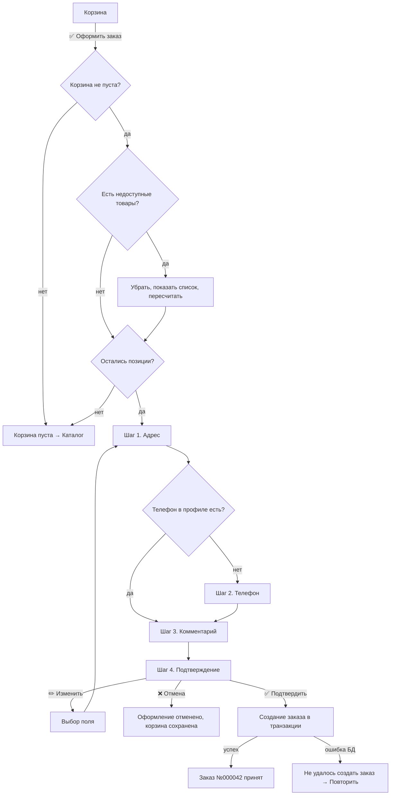

# Сценарий «Оформление заказа»

| | |
|---|---|
| Версия | 1.1 |
| Дата | 18.11.2026 |
| Автор | Ислам (студент 1, аналитик / тимлид) |
| Статус | Согласован с `requirements.md`, решения по открытым вопросам приняты |
| Реализует | Нурадыл (issue #1) |
| Связанные файлы | `bot/states.py`, `bot/handlers/cart.py`, `bot/handlers/order.py` (создать), `bot/services/orders.py` (создать), `admin_panel/delivery/models.py` |
| Связанные сценарии | `01-catalog.md`, `02-cart.md`, `04-my-orders.md`, `05-notifications.md`, `06-faq.md`, `07-operator.md` |
| Требования | `../requirements.md`, разделы 4.1, 5, 6, 8 |
| Затрагивает главу | Глава 1 (сценарии, TO-BE), Глава 2 (реализация FSM) |

---

## 1. Назначение и границы

**Назначение.** Описать пошаговый диалог, в котором клиент превращает корзину в заказ: адрес → телефон → комментарий → подтверждение → создание заказа в базе со статусом «Новый».

**Входит в сценарий:**

- вход из корзины по кнопке «✅ Оформить заказ»;
- сбор адреса доставки текстом;
- получение телефона кнопкой «Отправить номер» или вручную;
- необязательный комментарий;
- сводка заказа и подтверждение;
- создание заказа в одной транзакции;
- отмена оформления на любом шаге с сохранением корзины;
- обработка ошибок ввода и недоступных товаров.

**Не входит (отдельные сценарии):**

- каталог и карточка товара — `01-catalog.md`;
- корзина — `02-cart.md`;
- «Мои заказы» и отмена заказа клиентом — `04-my-orders.md`;
- уведомления о смене статуса — `05-notifications.md`;
- FAQ и связь с оператором — `06-faq.md`, `07-operator.md`;
- оплата заказа — вне MVP.

---

## 2. Участники и предусловия

| Роль | Что делает в этом сценарии |
|---|---|
| Клиент | Ведёт диалог в Telegram, вводит адрес, телефон, комментарий |
| Бот (aiogram 3) | Ведёт FSM, валидирует ввод, создаёт заказ |
| База (Django ORM) | Хранит `Client`, `Order`, `OrderItem` |
| Оператор | Не участвует в диалоге; видит готовый заказ в панели |

**Предусловия:**

1. Клиент зарегистрирован в базе (`/start` создал запись `Client`).
2. В корзине есть хотя бы одна доступная позиция.
3. Бот работает с той же базой, что и панель.

**Постусловия (успех):** создан `Order` со статусом `new`, позиции `OrderItem` с зафиксированной ценой, `Order.total` пересчитан, заказ виден оператору в панели.

**Постусловия (отмена):** заказ не создан, корзина сохранена в FSM-данных, бот вернулся в главное меню.

---

## 3. Принятые решения

Решения, которые сценарий требует сделать до реализации. Помечены как «рекомендация» — их нужно утвердить на созвоне.

| № | Вопрос | Решение в этом сценарии | Обоснование |
|---|---|---|---|
| 1 | Адрес: текст или геолокация | **Только текст**, 10–500 символов | В модели `Order.address` — `CharField(max_length=500)`, полей широты/долготы нет. Геолокация потребует миграции и расчёта расстояния — это расширение, не MVP |
| 2 | Когда спрашивать телефон | **При первом оформлении**, если `Client.phone` пуст. Если телефон уже сохранён — шаг пропускается | Телефон нужен только для доставки; спрашивать при `/start` — лишний барьер на входе |
| 3 | Как получать телефон | Кнопка «📱 Отправить номер» (`request_contact=True`) **или** ручной ввод | Кнопка исключает опечатки, ручной ввод нужен, если клиент оформляет заказ за другого человека |
| 4 | Комментарий | **Необязательный**, кнопка «Без комментария», до 500 символов | Поле `Order.comment` — `blank=True` |
| 5 | Стоимость доставки | **В MVP доставка бесплатна** и явно показывается строкой «Доставка: бесплатно» | В модели `Order` нет поля стоимости доставки. Скрывать этот факт нельзя — клиент должен видеть, из чего сложился итог. Решение принято, см. `../requirements.md`, раздел 8 |
| 6 | Отмена оформления клиентом | На любом шаге, корзина **сохраняется** | Отмена на этапе ввода — это отказ от диалога, а не от товаров |
| 7 | Язык | Только русский в MVP | Поле `Client.language` и `FAQ.language` есть, тексты на казахском — расширение |
| 8 | Двойное нажатие «Подтвердить» | Защита на уровне состояния FSM + проверка перед созданием | Иначе два тапа создадут два одинаковых заказа |

**Решение по доставке принято:** в MVP доставка бесплатна. Если позже появится платная доставка, нужна миграция `Order.delivery_fee` и пересчёт `total = товары + доставка`; пока этого поля нет.

---

## 4. Общая схема шагов



**Соответствие состояниям FSM (`bot/states.py`):**

| Шаг | Состояние `OrderForm` | Что хранится в FSM-данных |
|---|---|---|
| 1. Адрес | `address` | `cart` |
| 2. Телефон | `phone` | `cart`, `address` |
| 3. Комментарий | `comment` | `cart`, `address`, `phone` |
| 4. Подтверждение | `confirm` | `cart`, `address`, `phone`, `comment` |
| Редактирование | соответствующее поле + флаг `editing = true` | те же данные |

После успешного создания заказа или отмены — `state.clear()` и возврат главного меню.

---

## 5. Детальные шаги

Во всех шагах действует общее правило: **любой ввод, кроме текста** (фото, стикер, голосовое, документ) → бот отвечает «Пришлите, пожалуйста, текстом.» и остаётся в том же состоянии.

### Шаг 0. Вход из корзины

| | |
|---|---|
| **Триггер** | `CartCallback(action="checkout")` |
| **Проверка 1** | Корзина пуста → сообщение «Корзина пуста. Загляните в каталог 🛍» + кнопка «🛍 Каталог», выход |
| **Проверка 2** | Есть товары с `is_available = False` → убрать их из FSM-корзины, показать список убранного, пересчитать итог. Если ничего не осталось → как при пустой корзине |
| **Действие** | `state.set_state(OrderForm.address)`, показать шаг 1 |
| **Клавиатура** | Reply-клавиатура `[[«⬅️ Отменить»]]` — заменяет главное меню на время оформления |

> **Важно для реализации.** `bot/services/cart.py::get_cart_items()` фильтрует `is_available=True` и молча выбрасывает недоступные товары из отображения, но они остаются в FSM-данных `cart`. Если не выполнить сверку на шаге 0, клиент увидит в корзине одну сумму, а в подтверждении — другую. Сверка обязательна.

### Шаг 1. Адрес

**Текст бота:**

```
📝 Оформление заказа

Шаг 1 из 4. Куда доставить заказ?

Напишите адрес одним сообщением: город, улица, дом, квартира.
Например: Алматы, ул. Абая, 15, кв. 42
```

| Клиент делает | Бот отвечает | Кнопки | Если что-то не так |
|---|---|---|---|
| Пишет адрес текстом | Принимает, сохраняет в FSM, переходит к шагу 2 | «⬅️ Отменить» | Короче 10 символов → «Адрес слишком короткий…» |
| Пишет без номера дома | Принимает, но просит уточнить | «⬅️ Отменить» | «Похоже, не хватает номера дома. Добавьте, пожалуйста: улица, дом, квартира.» |
| Присылает фото/стикер | Остаётся в шаге 1 | «⬅️ Отменить» | «Пришлите, пожалуйста, адрес текстом.» |
| Нажимает «Отменить» | «Оформление отменено…» | Главное меню | Корзина сохранена |

**Правила валидации:**

| Правило | Значение | Сообщение при нарушении |
|---|---|---|
| Длина | от 10 до 500 символов после `strip()` | «Адрес слишком короткий. Укажите улицу, дом и квартиру — например: ул. Абая, 15, кв. 42.» / «Адрес слишком длинный, сократите до 500 символов.» |
| Номер дома | должна быть хотя бы одна цифра | «Похоже, не хватает номера дома. Добавьте, пожалуйста: улица, дом, квартира.» |

### Шаг 2. Телефон

**Пропускается**, если `Client.phone` не пуст — бот сразу переходит к шагу 3 и в сводке показывает сохранённый номер.

**Текст бота:**

```
📱 Шаг 2 из 4. Телефон для связи

Нажмите «Отправить номер» — так быстрее и без ошибок.
Или введите номер вручную: +7 777 123 45 67
```

| Клиент делает | Бот отвечает | Кнопки | Если что-то не так |
|---|---|---|---|
| Нажимает «📱 Отправить номер» | Берёт номер из контакта, нормализует, сохраняет в `Client.phone`, переходит к шагу 3 | «📱 Отправить номер», «⬅️ Отменить» | Контакт не свой → «Это номер другого человека. Введите нужный номер вручную.» |
| Вводит номер вручную | Нормализует, сохраняет, переходит к шагу 3 | «⬅️ Отменить» | Не распознан → «Не получилось распознать номер. Отправьте его кнопкой «📱 Отправить номер» или введите в формате +7 777 123 45 67.» |
| Присылает текст вместо номера | Остаётся в шаге 2 | «📱 Отправить номер», «⬅️ Отменить» | То же сообщение об ошибке |

**Правила нормализации и валидации:**

| Ввод клиента | Результат |
|---|---|
| `+7 777 123 45 67`, `+7 (777) 123-45-67` | `+77771234567` |
| `8 777 123 45 67`, `87771234567` | `+77771234567` |
| `77771234567` | `+77771234567` |
| `7771234567` (10 цифр) | `+77771234567` |
| Меньше 10 цифр, буквы, пустая строка | Ошибка, остаёмся в шаге 2 |

Нормализованный номер сохраняется в `Client.phone` (поле `max_length=32`, формат `+7XXXXXXXXXX` укладывается). При повторном заказе шаг 2 уже не показывается.

> **Решение принято:** нормализованный номер сохраняется в `Client.phone` в обоих случаях — и из контакта, и при ручном вводе. Отдельного поля телефона в `Order` нет, а курьеру нужен номер, по которому ответят. Клиент, оформляющий заказ за другого человека, может изменить номер через «✏️ Изменить → Телефон» на шаге подтверждения; новый номер станет основным в профиле. В дипломе разделим «телефон профиля» и «телефон заказа» (`Order.contact_phone`).

### Шаг 3. Комментарий

**Текст бота:**

```
💬 Шаг 3 из 4. Комментарий к заказу

Напишите, что важно учесть: подъезд, этаж, время доставки.
Или нажмите «Без комментария».
```

| Клиент делает | Бот отвечает | Кнопки | Если что-то не так |
|---|---|---|---|
| Пишет комментарий | Сохраняет, переходит к шагу 4 | «Без комментария», «⬅️ Отменить» | Длиннее 500 символов → «Комментарий слишком длинный, сократите до 500 символов.» |
| Нажимает «Без комментария» | Сохраняет пустую строку, переходит к шагу 4 | «Без комментария», «⬅️ Отменить» | — |
| Присылает фото | Остаётся в шаге 3 | «Без комментария», «⬅️ Отменить» | «Пришлите комментарий текстом или нажмите «Без комментария».» |

### Шаг 4. Подтверждение

**Текст бота (сводка):**

```
📋 Проверьте заказ

Состав:
• Маргарита: 2 × 2 900 = 5 800 ₸
• Кола 0,5: 1 × 450 = 450 ₸

Товары: 6 250 ₸
Доставка: бесплатно
Итого: 6 250 ₸

Адрес: Алматы, ул. Абая, 15, кв. 42
Телефон: +7 777 123 45 67
Комментарий: Позвонить за 10 минут

Всё верно?
```

| Клиент делает | Бот отвечает | Кнопки |
|---|---|---|
| Нажимает «✅ Подтвердить» | Создаёт заказ, показывает итоговое сообщение | — |
| Нажимает «✏️ Изменить» | Показывает меню выбора поля | «Адрес», «Телефон», «Комментарий», «⬅️ Назад к заказу» |
| Нажимает «❌ Отмена» | «Оформление отменено…», корзина сохранена | Главное меню |
| Пишет текст вместо нажатия кнопки | «Проверьте данные и нажмите «✅ Подтвердить» или «✏️ Изменить».» | Те же |

**Меню «Изменить»:**

```
✏️ Что изменить?
```

Выбор поля переводит в соответствующее состояние (`address` / `phone` / `comment`) с флагом `editing = true`. После корректного ввода бот **возвращается сразу к сводке**, а не проходит шаги заново.

**Перед показом сводки бот повторно сверяет корзину** (товар мог стать недоступен, пока клиент вводил адрес):

```
⚠️ Некоторые товары стали недоступны и убраны из заказа:
• Чизкейк

Итог пересчитан: 5 800 ₸.
```

Если после сверки корзина пуста:

```
Все товары из корзины стали недоступны. Выберите другие в каталоге.
```

### Шаг 5. Создание заказа

**Текст бота (успех):**

```
✅ Заказ №000042 принят!

Мы передали его оператору. Напишем, когда курьер выедет.
Следить за статусом: «📦 Мои заказы».
```

Номер — это `Order.number` (свойство модели: `f"{pk:06d}"`), поэтому в тексте всегда 6 цифр.

| Событие | Поведение |
|---|---|
| Заказ создан | `state.clear()`, возврат главного меню, корзина очищена |
| Двойное нажатие «Подтвердить» | Второй callback отвечает всплывающим «Заказ уже создан» и ничего не создаёт |
| Ошибка БД / таймаут | «Не удалось создать заказ. Попробуйте ещё раз через минуту.» Кнопки «🔁 Повторить», «❌ Отмена». Данные FSM сохраняются |
| Клиент заблокировал бота во время оформления | Заказ всё равно создаётся; уведомления по нему не доставляются (обрабатывается в сценарии уведомлений) |

---

## 6. Полный список текстов

Все тексты — в HTML-разметке Telegram (`parse_mode="HTML"`), пользовательский ввод экранируется через `html.escape()`.

| Код | Текст |
|---|---|
| `CHECKOUT_EMPTY` | Корзина пуста. Загляните в каталог 🛍 |
| `CHECKOUT_UNAVAILABLE` | ⚠️ Некоторые товары стали недоступны и убраны из заказа:\n{список}\n\nИтог пересчитан: {сумма} ₸. |
| `CHECKOUT_ALL_UNAVAILABLE` | Все товары из корзины стали недоступны. Выберите другие в каталоге. |
| `ASK_ADDRESS` | 📝 Оформление заказа\n\nШаг 1 из 4. Куда доставить заказ?\n\nНапишите адрес одним сообщением: город, улица, дом, квартира.\nНапример: Алматы, ул. Абая, 15, кв. 42 |
| `ADDRESS_TOO_SHORT` | Адрес слишком короткий. Укажите улицу, дом и квартиру — например: ул. Абая, 15, кв. 42. |
| `ADDRESS_TOO_LONG` | Адрес слишком длинный, сократите до 500 символов. |
| `ADDRESS_NO_HOUSE` | Похоже, не хватает номера дома. Добавьте, пожалуйста: улица, дом, квартира. |
| `ASK_PHONE` | 📱 Шаг 2 из 4. Телефон для связи\n\nНажмите «Отправить номер» — так быстрее и без ошибок.\nИли введите номер вручную: +7 777 123 45 67 |
| `PHONE_INVALID` | Не получилось распознать номер. Отправьте его кнопкой «📱 Отправить номер» или введите в формате +7 777 123 45 67. |
| `PHONE_FOREIGN_CONTACT` | Это номер другого человека. Введите нужный номер вручную. |
| `ASK_COMMENT` | 💬 Шаг 3 из 4. Комментарий к заказу\n\nНапишите, что важно учесть: подъезд, этаж, время доставки.\nИли нажмите «Без комментария». |
| `COMMENT_TOO_LONG` | Комментарий слишком длинный, сократите до 500 символов. |
| `SEND_TEXT_ONLY` | Пришлите, пожалуйста, текстом. |
| `CONFIRM_HEADER` | 📋 Проверьте заказ |
| `CONFIRM_WRONG_INPUT` | Проверьте данные и нажмите «✅ Подтвердить» или «✏️ Изменить». |
| `EDIT_MENU` | ✏️ Что изменить? |
| `ORDER_CREATED` | ✅ Заказ №{номер} принят!\n\nМы передали его оператору. Напишем, когда курьер выедет.\nСледить за статусом: «📦 Мои заказы». |
| `ORDER_FAILED` | Не удалось создать заказ. Попробуйте ещё раз через минуту. |
| `ORDER_ALREADY_CREATED` | Заказ уже создан. |
| `CHECKOUT_CANCELLED` | Оформление отменено. Корзина сохранена — вернуться можно кнопкой «🛒 Корзина». |

---

## 7. Обработка исключительных ситуаций

| Ситуация | Когда возникает | Поведение бота |
|---|---|---|
| Пустая корзина | «Оформить заказ» при пустой корзине | Сообщение + кнопка «🛍 Каталог», оформление не начинается |
| Товар стал недоступен | Между добавлением в корзину и оформлением | Убирается из корзины, клиент видит список и новый итог |
| Все товары недоступны | То же | Возврат в каталог |
| Изменилась цена товара | Между добавлением и подтверждением | В заказ пишется цена **на момент подтверждения**; если она отличается от показанной в корзине, бот предупреждает: «Цена на {товар} изменилась: {было} → {стало} ₸» |
| Неверный адрес | Шаг 1 | Остаёмся в шаге 1, показываем конкретную причину |
| Неверный телефон | Шаг 2 | Остаёмся в шаге 2 |
| Контакт другого человека | Шаг 2 | Отклоняем, просим свой номер |
| Слишком длинный комментарий | Шаг 3 | Остаёмся в шаге 3 |
| Нетекстовый ввод | Любой шаг | Просим текст, состояние не меняется |
| `/start` во время оформления | Любой шаг | Оформление прерывается, показывается главное меню, корзина сохраняется |
| Двойное подтверждение | Шаг 4 | Второй заказ не создаётся |
| Ошибка базы при создании | Шаг 5 | Сообщение об ошибке + «Повторить», FSM не сбрасывается |
| Клиент заблокировал бота | Шаг 5 | Заказ создаётся, доставка уведомления невозможна |
| Панель недоступна | — | Не влияет: бот пишет напрямую в общую базу |

---

## 8. Требования к реализации

### 8.1. Новые файлы

| Файл | Содержимое |
|---|---|
| `bot/handlers/order.py` | Роутер оформления: шаги 1–5, отмена, редактирование |
| `bot/keyboards/order.py` | Reply-клавиатуры шагов, inline-клавиатура подтверждения, `OrderCallback` |
| `bot/services/orders.py` | `create_order(...)`, `get_last_orders(...)`, проверка доступности корзины |
| `bot/services/validation.py` | `normalize_phone()`, `validate_address()`, `validate_comment()` |

### 8.2. Изменения в существующих файлах

| Файл | Что меняется |
|---|---|
| `bot/handlers/cart.py` | `checkout()` получает `state: FSMContext`, проверяет корзину, ставит `OrderForm.address` вместо заглушки |
| `bot/main.py` | Подключить роутер `order.router` |
| `bot/keyboards/main_menu.py` | Добавить «📦 Мои заказы» и «❓ Помощь» (нужны для шага 5 и следующих сценариев) |
| `bot/states.py` | Состояния уже есть; добавить комментарий о флаге `editing` в FSM-данных |

### 8.3. Callback-данные

```python
class OrderCallback(CallbackData, prefix="order"):
    action: str   # confirm, edit, edit_address, edit_phone, edit_comment,
                  # back, cancel, retry
```

### 8.4. Создание заказа

Одна транзакция, цена фиксируется в `OrderItem.price`, сумма считается моделью:

```python
@sync_to_async
def create_order(telegram_id: int, cart: dict[int, int], address: str, comment: str) -> Order:
    with transaction.atomic():
        client = Client.objects.get(telegram_id=telegram_id)
        order = Order.objects.create(client=client, address=address, comment=comment)
        for product in Product.objects.filter(pk__in=cart, is_available=True):
            OrderItem.objects.create(
                order=order, product=product,
                quantity=cart[product.pk], price=product.price,
            )
        order.recalculate_total()
    return order
```

Требования к функции:

1. Работает только с доступными товарами.
2. Не создаёт заказ, если после фильтрации не осталось ни одной позиции.
3. Возвращает созданный `Order` — из него берётся `order.number` для текста.
4. Вызывается ровно один раз на подтверждение.

### 8.5. Форматирование сумм

Сейчас `cart_text()` выводит `2 900` как `2900` (`{price:.0f}` без разделителя). В сводке и в заказе нужен единый формат с неразрывным пробелом: `2 900 ₸`. Требуется общая функция `format_money()` и её использование и в корзине, и в подтверждении — иначе корзина и сводка будут выглядеть по-разному.

---

## 9. Критерии приёмки

Тест-кейсы для проверки сценария (основа для таблицы тестов Нурдаулета, глава 3).

| № | Проверка | Ожидаемый результат |
|---|---|---|
| 1 | Новый клиент, полный путь | Заказ создан, статус «Новый», сумма совпадает с корзиной |
| 2 | Клиент с сохранённым телефоном | Шаг 2 пропущен, номер в сводке верный |
| 3 | Адрес короче 10 символов | Остаёмся в шаге 1, показывается причина |
| 4 | Адрес без цифры | Бот просит номер дома |
| 5 | Телефон `8 777 123 45 67` | Нормализован в `+77771234567`, сохранён в профиль |
| 6 | Телефон `12345` | Ошибка, шаг 2 не пройден |
| 7 | Контакт другого человека | Отклонён |
| 8 | «Без комментария» | Заказ создан с пустым комментарием |
| 9 | Комментарий 600 символов | Ошибка, шаг 3 не пройден |
| 10 | «Оформить заказ» при пустой корзине | Возврат в каталог, заказ не начат |
| 11 | Товар стал недоступен до подтверждения | Убран из заказа, итог пересчитан, клиент уведомлён |
| 12 | Двойное нажатие «Подтвердить» | Создан один заказ |
| 13 | «Отмена» на каждом шаге | Заказ не создан, корзина сохранена |
| 14 | `/start` во время оформления | Оформление прервано, корзина сохранена |
| 15 | Фото вместо адреса | Просьба прислать текст, состояние не изменилось |
| 16 | Заказ из бота | Виден в панели у оператора, позиции и сумма корректны |

---

## 10. Закрытые вопросы

Все вопросы, которые были открыты в версии 1.0, решены. Полный реестр решений — `README.md`, раздел «Реестр решений»; требования обновлены в `../requirements.md`, раздел 9.

| № | Вопрос | Решение | Где применяется |
|---|---|---|---|
| 1 | Стоимость доставки | Бесплатно, строкой «Доставка: бесплатно» | Сводка, `Order` без `delivery_fee` |
| 2 | Номер, введённый для другого человека | Сохраняется в профиль; в дипломе — `Order.contact_phone` | Шаг 2, «Изменить → Телефон» |
| 3 | Казахский язык | Нет в MVP, только русский | Все тексты, `Client.language` |
| 4 | Отмена заказа клиентом | Только в статусе `new`, дальше — оператор | `04-my-orders.md` |
| 5 | Кто отправляет уведомления | Единый модуль `notifications`, вызывается из `OrderService` | `05-notifications.md` |

**Что осталось открытым и не блокирует реализацию:** фото товаров в каталоге, кнопка «Вернуть» после удаления из корзины, ответ оператора на сайте в чате. Эти вопросы не меняют шаг 5 и создание заказа.
