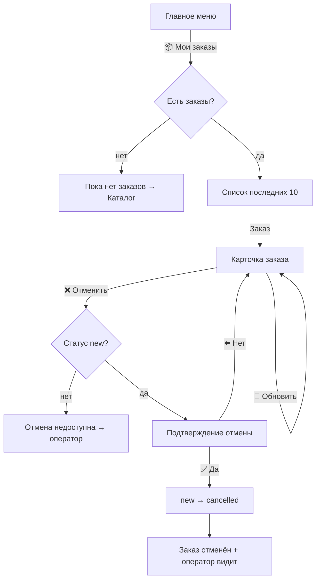

# Сценарий «Мои заказы» и отмена заказа клиентом

| | |
|---|---|
| Версия | 1.0 |
| Дата | 18.11.2026 |
| Автор | Ислам (студент 1, аналитик / тимлид) |
| Статус | Черновик, на согласовании с командой |
| Реализует | Нурадыл — бот; Нурдаулет — сайт |
| Связанные сценарии | `03-checkout.md`, `05-notifications.md`, `07-operator.md` |
| Требования | FR-BOT-18, FR-BOT-19, FR-WEB-04, FR-WEB-05, FR-ADM-09, FR-NOT-01 |
| Затрагивает главу | Глава 1 (TO-BE), Глава 2 (реализация статусов) |

---

## 1. Назначение и границы

**Назначение.** Дать клиенту возможность посмотреть свои заказы, увидеть актуальный статус, состав и сумму, а также отменить заказ, пока его не взял оператор. На сайте — проверить статус заказа по номеру и телефону.

**Входит в сценарий:**

- список последних заказов клиента в боте;
- карточка заказа: статус, состав, суммы, адрес, дата;
- обновление статуса по кнопке;
- отмена заказа клиентом в допустимом статусе;
- проверка статуса на сайте по номеру заказа и телефону;
- отображение источника заказа (бот/сайт) в панели.

**Не входит (отдельные сценарии):**

- создание заказа — `03-checkout.md`;
- уведомления о смене статуса — `05-notifications.md`;
- смена статусов оператором и курьером, причины отмены оператором — `07-operator.md`;
- возвраты денег и повторный заказ в один тап — вне MVP.

**Ключевое правило.** Клиент видит только свои заказы. В боте — по `telegram_id`, на сайте — по паре «номер заказа + телефон» (FR-WEB-04).

---

## 2. Участники и предусловия

| Роль | Что делает в этом сценарии |
|---|---|
| Клиент | Открывает список, смотрит детали, обновляет статус, отменяет заказ |
| Бот | Отдаёт заказы клиента, проверяет право на отмену, пишет статус |
| Сайт | Ищет заказ по номеру и телефону, показывает тот же статус |
| Оператор | Меняет статус; после `accepted` отмена клиентом невозможна |
| База | Хранит `Order`, `OrderItem`, `OrderStatusHistory` |

**Предусловия:**

1. У клиента есть хотя бы один заказ.
2. Клиент обращается из того же Telegram-аккаунта, с которого заказывал, либо вводит номер и телефон на сайте.

**Постусловия (просмотр):** клиент увидел актуальный статус и состав, данные не изменились.

**Постусловия (отмена):** заказ переведён в `cancelled`, причина `client_request`, оператор видит отмену в панели, клиент получил подтверждение.

---

## 3. Принятые решения

| № | Вопрос | Решение в MVP | Обоснование |
|---|---|---|---|
| 1 | Какие заказы показывать | Последние 10, новые сверху | Больше в боте не читается; полная история — на сайте и в панели |
| 2 | До какого статуса клиент может отменить | **Только `new`** | `03-checkout.md` и требования говорили «до передачи курьеру»; на практике после `accepted` заказ уже готовят, а после `assigned` за него отвечает курьер. Один понятный рубеж проще объяснить клиенту и проверить в коде |
| 3 | Что происходит после `accepted` | Кнопка отмены скрыта, показывается «Заказ уже принят. Чтобы отменить, свяжитесь с оператором» | Не обещаем клиенту действие, которое не сможем выполнить |
| 4 | Кто может отменить | Только владелец заказа | Проверка `order.client.telegram_id == message.from_user.id` на каждом callback |
| 5 | Причина отмены | `client_request`, без свободного текста | Причину оператору видно в панели; текст клиента не обязателен |
| 6 | Обновление статуса | По кнопке «🔄 Обновить» + автоматически при открытии карточки | Push-обновления в боте нет; кнопка даёт клиенту контроль |
| 7 | Проверка на сайте | Номер заказа + полный телефон | Номер заказа сам по себе легко подобрать (6 цифр), телефон — второй фактор |
| 8 | Ответ при неверной паре | Одинаковый: «Заказ не найден. Проверьте номер и телефон.» | Чтобы нельзя было перебором узнать, существует ли заказ |
| 9 | Защита от перебора на сайте | 10 попыток в минуту с одного IP, затем 429 на 10 минут | Простая защита без капчи |
| 10 | История статусов | Показывается клиенту (S) и хранится в `OrderStatusHistory` | Требование FR-ADM-09 и основа для разбора спорных ситуаций |
| 11 | Отмена оператором | Клиент получает уведомление с причиной | См. `05-notifications.md` |
| 12 | Удаление заказа | Запрещено | История нужна для отчётности и споров |

**Почему рубеж отмены — `new`.** Оператор подтверждает заказ в среднем за 1–3 минуты. Если разрешить отмену до `assigned`, клиент может отменить заказ, который курьер уже взял, и панель окажется в противоречии с реальностью. В дипломе рубеж можно расширить до `assigned` — это одна проверка в сервисе, а не переделка сценария.

---

## 4. Общая схема шагов



**Соответствие состояниям FSM.** Список и карточка работают на inline-callback'ах. Отдельное состояние нужно только подтверждению отмены, чтобы клиент не мог случайно нажать «Да» повторно: `CancelOrder.confirm` с `order_id` в FSM-данных. После ответа состояние очищается.

---

## 5. Детальные шаги бота

### Шаг 1. Список заказов

**Текст бота:**

```
📦 Мои заказы

1. №000042 — 🚚 В пути — 6 250 ₸ — 18.11, 14:20
2. №000039 — ✅ Доставлен — 4 100 ₸ — 17.11, 19:05
3. №000036 — ❌ Отменён — 2 900 ₸ — 16.11, 12:40

Показаны последние 10 заказов.
```

| Клиент делает | Бот отвечает | Кнопки |
|---|---|---|
| Нажимает «📦 Мои заказы» | Список с номером, статусом, суммой и датой | По заказу в ряд: «№000042 — 🚚 В пути»; ниже «🛍 Каталог», «⬅️ В меню» |
| Заказов нет | `Пока нет заказов. Самое время что-нибудь выбрать 🛍` | «🛍 Каталог» |

Правила:

- сортировка по `created_at DESC`;
- статус показывается словом и эмодзи, а не техническим кодом;
- сумма — `Order.total`, а не пересчёт из текущих цен каталога;
- дата — в часовом поясе клиента (Алматы, UTC+5), формат `ДД.ММ, ЧЧ:ММ`.

### Шаг 2. Карточка заказа

**Текст бота:**

```
📦 Заказ №000042
Статус: 🚚 В пути
Создан: 18.11.2026, 14:20

Состав:
• Маргарита — 2 × 2 900 = 5 800 ₸
• Кола 0,5 — 1 × 450 = 450 ₸

Товары: 6 250 ₸
Доставка: бесплатно
Итого: 6 250 ₸

Адрес: Алматы, ул. Абая, 15, кв. 42
Телефон: +7 777 123 45 67
Комментарий: Позвонить за 10 минут

История:
• 18.11, 14:20 — создан
• 18.11, 14:22 — принят оператором
• 18.11, 14:35 — передан курьеру
• 18.11, 14:40 — в пути
```

| Клиент делает | Бот отвечает | Кнопки |
|---|---|---|
| Открывает заказ | Карточка с составом и статусом | «🔄 Обновить»; «❌ Отменить заказ» — только при `new`; «⬅️ К списку» |
| Нажимает «🔄 Обновить» | Карточка перерисовывается, статус актуальный | Если статус не изменился — всплывающее «Статус не изменился» |
| Статус `delivered` | Вместо отмены — «🙏 Спасибо за заказ!» | «🛍 Заказать ещё», «⬅️ К списку» |
| Статус `cancelled` | Показывается причина, если её указал оператор | «🛍 Заказать ещё», «⬅️ К списку» |

Правила:

- цена позиции берётся из `OrderItem.price`, а не из `Product` — иначе история изменится после правки каталога (требования, раздел 6);
- адрес и комментарий экранируются через `html.escape()`;
- телефон в карточке показывается в читаемом виде `+7 777 123 45 67`, в базе хранится `+77771234567`;
- «История» показывается, если в базе есть `OrderStatusHistory`; при её отсутствии блок скрывается, карточка не ломается.

### Шаг 3. Отмена заказа клиентом

**Условие:** `order.status == new` и заказ принадлежит клиенту.

| Шаг | Текст | Кнопки |
|---|---|---|
| 1. Нажатие «❌ Отменить заказ» | `Отменить заказ №000042 на 6 250 ₸?\n\nЕсли передумали — вернитесь к заказу.` | «✅ Да, отменить», «⬅️ Нет, оставить» |
| 2. «✅ Да, отменить» | Переход `new → cancelled`, причина `client_request` | — |
| 3. Успех | `Заказ №000042 отменён.\n\nЕсли что-то пошло не так, напишите оператору.` | «🛍 Каталог», «❓ Помощь» |
| 4. Статус уже изменился | `Заказ уже принят оператором — отменить его нельзя.\nСвяжитесь с оператором, он поможет.` | «💬 Связаться с оператором», «⬅️ К заказу» |

Технически отмена — одно условное обновление, а не «прочитать → проверить → записать»:

```python
updated = Order.objects.filter(
    pk=order_id,
    client__telegram_id=telegram_id,
    status=Order.Status.NEW,
).update(
    status=Order.Status.CANCELLED,
    cancelled_by=Order.CancelledBy.CLIENT,
    cancel_reason=Order.CancelReason.CLIENT_REQUEST,
    cancelled_at=timezone.now(),
)
```

Если `updated == 0` — заказ не принадлежит клиенту или уже не `new`. Оба случая показываются одним сообщением без подробностей.

После успешной отмены:

1. запись в `OrderStatusHistory` (`from=new`, `to=cancelled`, `actor=client`);
2. вызов единого сервиса уведомлений — оператору в панель, клиенту сообщение не дублируется (`05-notifications.md`, п. 3.10);
3. `state.clear()`.

### Шаг 4. Проверка статуса на сайте

| Шаг | Что видит клиент | Поведение |
|---|---|---|
| Открывает «Статус заказа» | Форма: номер заказа и телефон | Поля обязательные |
| Вводит `42` или `000042` | Принимается оба варианта | Номер нормализуется к 6 цифрам |
| Вводит верную пару | Карточка заказа: статус, состав, суммы, адрес, дата | Те же данные, что в боте |
| Вводит неверную пару | `Заказ не найден. Проверьте номер и телефон.` | Одинаковый ответ, без подсказок |
| Вводит 11 попыток за минуту | `Слишком много попыток. Попробуйте через 10 минут.` | HTTP 429 |
| Заказ отменён | Показывается «Отменён» и причина, если указана | — |

Правила сайта:

- телефон сравнивается после нормализации, а не по строке: `8 777…` и `+7 777…` — один номер;
- в ответе нет `telegram_id` и внутренних id;
- адрес показывается полностью только после успешной проверки пары;
- страница работает без авторизации — это осознанно, иначе клиенту с сайта придётся заводить аккаунт.

---

## 6. Полный список текстов бота

| Код | Текст |
|---|---|
| `MY_ORDERS_TITLE` | 📦 Мои заказы |
| `MY_ORDERS_EMPTY` | Пока нет заказов. Самое время что-нибудь выбрать 🛍 |
| `MY_ORDERS_ITEM` | {номер}. №{номер} — {статус} — {сумма} ₸ — {дата} |
| `MY_ORDERS_LIMIT` | Показаны последние 10 заказов. |
| `ORDER_CARD` | 📦 Заказ №{номер}\nСтатус: {статус}\nСоздан: {дата}\n\nСостав:\n{позиции}\n\nТовары: {сумма} ₸\nДоставка: бесплатно\nИтого: {сумма} ₸\n\nАдрес: {адрес}\nТелефон: {телефон}\nКомментарий: {комментарий} |
| `ORDER_HISTORY` | История:\n{строки} |
| `ORDER_NOT_CHANGED` | Статус не изменился. |
| `ORDER_CANCEL_ASK` | Отменить заказ №{номер} на {сумма} ₸?\n\nЕсли передумали — вернитесь к заказу. |
| `ORDER_CANCEL_DONE` | Заказ №{номер} отменён.\n\nЕсли что-то пошло не так, напишите оператору. |
| `ORDER_CANCEL_TOO_LATE` | Заказ уже принят оператором — отменить его нельзя.\nСвяжитесь с оператором, он поможет. |
| `ORDER_CANCEL_FAILED` | Не удалось отменить заказ. Попробуйте ещё раз или свяжитесь с оператором. |
| `ORDER_CANCELLED_BY_OPERATOR` | Заказ №{номер} отменён оператором. Причина: {причина}. |
| `ORDER_DELIVERED_THANKS` | 🙏 Спасибо за заказ! Будем рады видеть снова. |

**Статусы для клиента:**

| Код | Текст | Эмодзи |
|---|---|---|
| `new` | Новый | 🕐 |
| `accepted` | Принят | ✅ |
| `assigned` | Передан курьеру | 🛵 |
| `in_transit` | В пути | 🚚 |
| `delivered` | Доставлен | ✅ |
| `cancelled` | Отменён | ❌ |

---

## 7. Обработка исключительных ситуаций

| Ситуация | Когда возникает | Поведение |
|---|---|---|
| Заказов нет | Первый заход | `MY_ORDERS_EMPTY` + «🛍 Каталог» |
| Чужой заказ | Подмена `order_id` в callback | «Заказ не найден», действие не выполняется, попытка в лог |
| Заказ уже не `new` | Клиент жал «Отменить» одновременно с оператором | `ORDER_CANCEL_TOO_LATE` |
| Двойное «Да, отменить» | Повторный callback | Второй получает «Заказ уже отменён» |
| Заказ удалён | Между открытием списка и карточкой | «Заказ не найден», возврат к списку |
| Статус не изменился | «🔄 Обновить» | Всплывающее `ORDER_NOT_CHANGED`, сообщение не редактируется |
| Заказ отменил оператор | Клиент открывает карточку | Показывается «Отменён» + причина |
| Телефон в заказе изменён | Клиент редактировал профиль | Карточка показывает телефон из заказа/профиля на момент оформления; в MVP — текущий `Client.phone` |
| Сайт: неверный номер | Перебор | Одинаковый ответ, 429 после 10 попыток |
| Сайт: заказ с бота | Клиент проверяет статус на сайте | Работает: источник не влияет на поиск |
| Ошибка базы | Запрос упал | «Не удалось загрузить заказы. Попробуйте ещё раз.» + «🔁 Повторить» |

---

## 8. Требования к реализации

### 8.1. Файлы

| Файл | Содержимое |
|---|---|
| `bot/handlers/my_orders.py` | Список, карточка, обновление, отмена |
| `bot/keyboards/my_orders.py` | Inline-клавиатуры, `MyOrdersCallback` |
| `bot/services/orders.py` | `get_last_orders()`, `get_order_for_client()`, `cancel_by_client()` |
| `site/orders/views.py` | Страница проверки статуса, rate limit |
| `admin_panel/delivery/models.py` | `OrderStatusHistory`, поля отмены (миграция) |

### 8.2. Callback-данные

```python
class MyOrdersCallback(CallbackData, prefix="my"):
    action: str              # list, view, refresh, cancel, cancel_confirm, cancel_abort, back
    order_id: int | None = None
```

### 8.3. Запросы

```python
# Список: только свои, без N+1
Order.objects.filter(client__telegram_id=telegram_id) \
    .select_related("client") \
    .prefetch_related("items__product") \
    .order_by("-created_at")[:10]
```

Требования:

1. Каждый callback с `order_id` проверяет владельца, а не только существование заказа.
2. Отмена — атомарное `filter(status=NEW).update(...)`; никаких `save()` после чтения.
3. `Order.total` не пересчитывается при просмотре — он зафиксирован при создании.
4. История статусов пишется в той же транзакции, что и смена статуса.
5. Сайт и бот используют один сервис `cancel_by_client()` — поведение не должно расходиться.

---

## 9. Критерии приёмки

| № | Проверка | Ожидаемый результат |
|---|---|---|
| 1 | «📦 Мои заказы» с тремя заказами | Список из 3, новые сверху |
| 2 | Открыть заказ | Состав, суммы, адрес, телефон, комментарий |
| 3 | Цену товара изменили после заказа | В карточке старая цена из `OrderItem` |
| 4 | Заказ в `new` | Кнопка «❌ Отменить заказ» есть |
| 5 | Отмена в `new` | Заказ отменён, причина `client_request` |
| 6 | Заказ в `accepted` | Кнопки отмены нет, подсказка про оператора |
| 7 | Отмена одновременно с оператором | Клиент видит «уже принят», второй записи нет |
| 8 | Повторное «Да, отменить» | Второй раз ничего не меняет |
| 9 | Чужой `order_id` в callback | «Заказ не найден», данные не показаны |
| 10 | «🔄 Обновить» без изменений | Всплывающее «Статус не изменился» |
| 11 | Оператор отменил заказ | Клиент видит «Отменён» и причину |
| 12 | Сайт: верные номер и телефон | Карточка заказа |
| 13 | Сайт: `8 777…` вместо `+7 777…` | Заказ найден |
| 14 | Сайт: неверный телефон | «Заказ не найден» без подсказок |
| 15 | Сайт: 11 попыток за минуту | 429, сообщение о блокировке |
| 16 | Заказ из бота проверяется на сайте | Найден, статус совпадает |
| 17 | Удаление заказа в панели | Невозможно (запрещено) |

---

## 10. Открытые вопросы

| № | Вопрос | Кого касается | Влияние |
|---|---|---|---|
| 1 | Расширить отмену до `assigned` | Ислам, Нурадыл, Нурдаулет | Одна проверка в сервисе; меняет текст подсказки |
| 2 | Показывать ли клиенту историю статусов в MVP | Нурадыл | Если `OrderStatusHistory` не готова — блок скрывается |
| 3 | Нужен ли повтор заказа в один тап | все | Удобно, но требует отдельного сценария и проверки доступности |
| 4 | Показывать ли на сайте все заказы по телефону без номера | Нурдаулет | Удобнее, но слабее защита от перебора |
