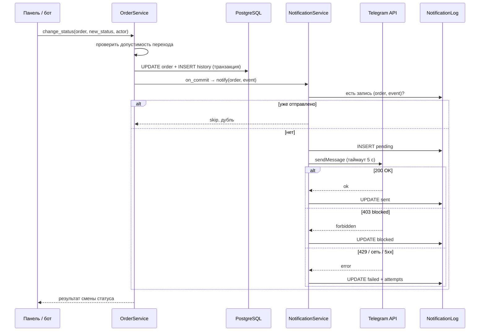

# Сценарий «Уведомления о смене статуса»

| | |
|---|---|
| Версия | 1.0 |
| Дата | 18.11.2026 |
| Автор | Ислам (студент 1, аналитик / тимлид) |
| Статус | Черновик, на согласовании с командой |
| Реализует | Нурадыл — отправка и тексты; Нурдаулет — вызов из панели и лог |
| Связанные сценарии | `03-checkout.md`, `04-my-orders.md`, `07-operator.md` |
| Требования | FR-NOT-01 … FR-NOT-04, FR-ADM-01, FR-ADM-09, NFR-09 |
| Затрагивает главу | Глава 1 (TO-BE), Глава 2 (интеграция бота и панели) |

---

## 1. Назначение и границы

**Назначение.** Описать, как клиент узнаёт о смене статуса заказа: кто отправляет сообщение, в какой момент, что происходит при ошибке и как не отправить одно и то же дважды.

**Входит в сценарий:**

- сообщения клиенту на переходах `new → accepted`, `accepted → assigned`, `assigned → in_transit`, `in_transit → delivered`, `* → cancelled`;
- единая точка отправки для бота и панели;
- защита от дублей при повторной смене статуса и повторном сохранении заказа;
- обработка блокировки бота клиентом, таймаутов и лимитов Telegram;
- журнал отправок и индикатор «не доставлено» в панели.

**Не входит (отдельные сценарии):**

- сообщение «Заказ принят» после оформления — это ответ бота на действие клиента в `03-checkout.md`, шаг 5;
- смена статусов и причины отмены — `07-operator.md`;
- уведомление оператора о новом заказе — `07-operator.md`, п. 5.1;
- SMS, WhatsApp, e-mail и push на сайте — вне MVP;
- маркетинговые рассылки — вне MVP.

**Главное правило.** Статус меняет только сервис `OrderService.change_status()`, и только он вызывает `NotificationService`. Ни представления панели, ни обработчики бота не отправляют сообщения сами (FR-NOT-04).

---

## 2. Участники и предусловия

| Роль | Что делает в этом сценарии |
|---|---|
| Оператор / курьер | Меняет статус в панели (или бот — при отмене клиентом) |
| `OrderService` | Проверяет допустимость перехода, пишет историю, вызывает уведомления |
| `NotificationService` | Формирует текст, отправляет в Telegram, пишет журнал |
| Telegram Bot API | Доставляет сообщение клиенту |
| Клиент | Получает сообщение, может открыть «Мои заказы» |
| Панель | Показывает, доставлено ли уведомление |

**Предусловия:**

1. Заказ существует, у него есть клиент.
2. Переход статуса допустим по правилам из `requirements.md`, раздел 5.
3. В окружении задан `TELEGRAM_BOT_TOKEN`.

**Постусловия (успех):** клиент получил ровно одно сообщение о переходе, в `NotificationLog` запись `sent`, в панели отметка «доставлено».

**Постусловия (ошибка):** статус всё равно изменён, заказ обрабатывается дальше, в журнале `failed`/`blocked`, оператор видит предупреждение и может позвонить.

---

## 3. Принятые решения

| № | Вопрос | Решение в MVP | Обоснование |
|---|---|---|---|
| 1 | Кто отправляет уведомления | Один модуль `notifications/services.py` в Django-проекте; его вызывают и панель, и бот | Прямой ответ на открытый вопрос №5 из `requirements.md`. Бот и панель работают с одной базой и одним кодом моделей, отдельный сервис-демон для MVP избыточен |
| 2 | Точка вызова | Только `OrderService.change_status()`; сигналы `post_save` не используются | `post_save` срабатывает на любое сохранение (правка комментария, пересчёт суммы) и даёт дубли |
| 3 | Когда отправлять | После `transaction.on_commit`, чтобы не отправить сообщение об откатившемся переходе | Иначе клиент получит «Курьер выехал» по заказу, который не сохранился |
| 4 | Синхронно или через очередь | Синхронно из потока запроса, таймаут 5 секунд; ошибки не пробрасываются в интерфейс | MVP без Celery. Панель может подождать 5 секунд, но не должна падать. В дипломе — очередь и повторные попытки |
| 5 | Защита от дублей | Уникальный индекс `NotificationLog(order, event)`; перед отправкой проверяется существующая запись | Повторный клик оператора или ретрай не создаёт второе сообщение |
| 6 | Что считается событием | Статус назначения: `accepted`, `assigned`, `in_transit`, `delivered`, `cancelled` | Создание заказа (`new`) — часть диалога оформления, отдельное сообщение не нужно |
| 7 | Заказ с сайта без Telegram | Если у клиента нет `telegram_id`, сообщение не отправляется; статус клиент смотрит на сайте по номеру и телефону | SMS-шлюза в MVP нет. В журнале — `skipped_no_channel` |
| 8 | Клиент заблокировал бота | Telegram отвечает 403 — пишем `blocked`, повторов нет, заказ живёт дальше | FR-NOT-03 |
| 9 | Лимит Telegram (429) | Одна повторная попытка после `retry_after`, затем `failed` | Не задерживаем оператора дольше 5 секунд |
| 10 | Отмена клиентом | Клиенту сообщение не дублируется (он только что видел подтверждение в боте), оператору — событие в панели | Иначе клиент получает два сообщения подряд об одном действии |
| 11 | Порядок сообщений | Переходы одного заказа выполняются последовательно; следующий статус нельзя поставить, пока предыдущий не зафиксирован | Правила переходов из `requirements.md`, раздел 5, уже это обеспечивают |
| 12 | Текст сообщения | Шаблон в коде, данные из базы; суммы через `format_money()`; пользовательские строки экранируются | Единый формат и защита от HTML-инъекции |
| 13 | Кнопка в сообщении | «📦 Мои заказы» — inline-callback бота | Клиент сразу видит детали, не вводя номер |
| 14 | Хранение токена | Только переменная окружения | NFR-05 |

**Почему не сигнал модели.** Соблазн повесить отправку на `post_save(Order)` велик, но тогда любое сохранение заказа (например, оператор поправил комментарий) отправит уведомление. Сигнал не знает, была ли смена статуса и кто её сделал. Явный вызов из сервиса — единственный способ гарантировать «одно сообщение на один переход».

---

## 4. Общая схема



**Границы компонентов:**

| Компонент | Отвечает за |
|---|---|
| `OrderService.change_status()` | Проверка перехода, транзакция, история, вызов уведомлений |
| `NotificationService` | Текст, отправка, журнал, обработка ошибок |
| Панель | Кнопки статусов, индикатор доставки уведомления |
| Бот | Отмена клиентом → тот же `OrderService`; кнопка «Мои заказы» |

---

## 5. Сообщения по статусам

### 5.1. Таблица переходов и текстов

| Событие | Кому | Текст | Кнопки |
|---|---|---|---|
| `accepted` | Клиент | `✅ Оператор подтвердил заказ №000042.\n\nГотовим его. Напишем, когда курьер выедет.` | «📦 Мои заказы» |
| `assigned` | Клиент | `🛵 Курьер назначен.\n\nЗаказ №000042 передали курьеру {имя}.\nТелефон курьера: {телефон}.` | «📦 Мои заказы» |
| `in_transit` | Клиент | `🚚 Курьер выехал!\n\nЗаказ №000042 в пути. Пожалуйста, будьте на связи — курьер позвонит.` | «📦 Мои заказы» |
| `delivered` | Клиент | `✅ Заказ №000042 доставлен.\n\nСпасибо, что выбрали нас! Будем рады видеть снова.` | «🛍 Каталог» |
| `cancelled` (оператор) | Клиент | `❌ Заказ №000042 отменён.\n\nПричина: {причина}.\nЕсли это ошибка — свяжитесь с оператором.` | «💬 Связаться с оператором» |
| `cancelled` (клиент) | Клиент | сообщение не отправляется — клиент видит подтверждение в диалоге отмены | — |
| любой переход | Оператор | Событие в ленте панели, без Telegram-сообщения | — |

**Причины отмены:**

| Код | Текст для клиента |
|---|---|
| `client_request` | вы отменили заказ |
| `out_of_stock` | закончились продукты для этого заказа |
| `no_courier` | не удалось назначить курьера |
| `address_error` | не удалось подтвердить адрес доставки |
| `other` | комментарий оператора, если он заполнен |

Если оператор выбрал `other` и не написал комментарий, используется `заказ отменён оператором`.

### 5.2. Требования к текстам

1. Номер заказа — всегда 6 цифр (`Order.number`).
2. Сумма в сообщении не дублируется: клиент может открыть «Мои заказы». Исключение — сообщение об отмене, где полезна сумма? В MVP **не дублируем**: карточка заказа всегда под рукой.
3. Имя и телефон курьера экранируются через `html.escape()`.
4. Разметка — только `parse_mode="HTML"`, без Markdown.
5. Ссылки отключены (`disable_web_page_preview=True`), чтобы сообщение не разворачивалось в превью.
6. Сообщение не содержит адреса и состава — это личные данные, они остаются в карточке заказа по кнопке.

---

## 6. Данные

### 6.1. Новая таблица `NotificationLog`

| Поле | Тип | Назначение |
|---|---|---|
| `id` | PK | — |
| `order` | FK `Order`, `on_delete=CASCADE` | Заказ |
| `event` | `CharField(20)`, choices: `accepted`, `assigned`, `in_transit`, `delivered`, `cancelled` | Событие |
| `channel` | `CharField(16)`, по умолчанию `telegram` | Канал |
| `status` | `CharField(16)`: `pending`, `sent`, `failed`, `blocked`, `skipped_no_channel` | Результат |
| `attempts` | `PositiveSmallIntegerField`, по умолчанию 0 | Число попыток |
| `error_code` | `CharField(32)`, blank | `403`, `429`, `timeout`, `network` |
| `error_text` | `TextField`, blank | Ответ Telegram, обрезанный до 500 символов |
| `created_at` | `DateTimeField(auto_now_add)` | Когда создана запись |
| `sent_at` | `DateTimeField(null=True)` | Когда доставлено |

Ограничения:

- `unique_together = ("order", "event", "channel")` — один переход, одно сообщение;
- индекс `(order, created_at)` для карточки заказа в панели;
- миграция создаётся вместе с полями отмены заказа (`cancelled_by`, `cancel_reason`, `cancelled_at`).

### 6.2. Связь с историей статусов

`OrderStatusHistory` отвечает на вопрос «кто и когда изменил статус», `NotificationLog` — «дошло ли сообщение до клиента». Это разные журналы, и смешивать их нельзя: история статусов не должна зависеть от доступности Telegram.

---

## 7. Обработка исключительных ситуаций

| Ситуация | Код/причина | Поведение |
|---|---|---|
| Клиент заблокировал бота | 403 `Forbidden: bot was blocked by the user` | `blocked`, без повторов, заказ обрабатывается, в панели значок «не доставлено» |
| Клиент удалил аккаунт | 400 `chat not found` | `failed`, без повторов, значок в панели |
| Слишком много сообщений | 429 `Too Many Requests` | Ждём `retry_after` (не больше 5 с) и пробуем один раз; иначе `failed` |
| Telegram недоступен | timeout / сеть | `failed`, `attempts=1`; оператор видит предупреждение |
| Сервер Telegram 5xx | 5xx | `failed`, одна повторная попытка через 2 секунды |
| Нет токена в окружении | конфигурация | Приложение не стартует в production; в dev — `skipped_no_channel` и запись в лог |
| Нет `telegram_id` у клиента | заказ с сайта | `skipped_no_channel`; статус доступен на сайте |
| Переход недопустим | `InvalidTransition` | Уведомление не создаётся, оператор видит ошибку перехода |
| Повторная смена на тот же статус | — | Переход отклоняется, дубля нет |
| Ошибка БД при записи журнала | — | Уведомление не отправляется: лучше не отправить, чем отправить без следа |
| Заказ отменён до отправки | гонка | `on_commit` проверяет актуальный статус перед отправкой; устаревшее событие пропускается |

**Принцип:** проблема с уведомлением никогда не отменяет смену статуса. Заказ важнее сообщения. Но каждая проблема видна оператору и в логах (NFR-09).

---

## 8. Требования к реализации

### 8.1. Файлы

| Файл | Содержимое |
|---|---|
| `notifications/services.py` | `notify_status_change(order, event, actor=None)`, `build_message()`, `send_telegram()` |
| `notifications/models.py` | `NotificationLog` |
| `notifications/templates.py` | Шаблоны текстов (или константы в `messages.py`) |
| `admin_panel/delivery/services/orders.py` | `OrderService.change_status()` — единственная точка смены статуса |
| `admin_panel/delivery/models.py` | `OrderStatusHistory`, поля отмены |
| `admin_panel/delivery/views.py` | Кнопки статусов вызывают только `change_status()` |

### 8.2. Контракт сервиса

```python
def change_status(order_id: int, new_status: str, actor, *, reason: str = "") -> Order:
    """Меняет статус, пишет историю и ставит уведомление в on_commit."""

def notify_status_change(order: Order, event: str, actor=None) -> NotificationLog:
    """Идемпотентно отправляет одно сообщение по событию."""
```

Требования:

1. `notify_status_change()` не бросает исключений наружу — возвращает запись журнала.
2. Перед отправкой проверяется `NotificationLog.objects.filter(order=order, event=event, channel="telegram").first()`.
3. Отправка — `httpx.post(..., timeout=5)`; повторные попытки только для 429 и 5xx.
4. Текст собирается одной функцией, чтобы бот и панель не расходились.
5. Суммы — через `format_money()`.
6. Токен — `settings.TELEGRAM_BOT_TOKEN` из окружения.
7. В лог приложения пишется `order_id`, `event`, `status`, `error_code`; текст сообщения и телефон — нет.
8. Панель показывает по заказу последний `NotificationLog`: «доставлено», «не доставлено (бот заблокирован)», «нет Telegram».

### 8.3. Как вызывается из бота

```python
@sync_to_async
def cancel_order_by_client(telegram_id: int, order_id: int) -> bool:
    return OrderService.cancel_by_client(telegram_id, order_id)
```

Бот не отправляет сообщение об отмене сам — только показывает результат диалога. Если `cancel_by_client()` меняет статус, сервис уведомлений сам решит, кому и что отправить.

---

## 9. Критерии приёмки

| № | Проверка | Ожидаемый результат |
|---|---|---|
| 1 | Оператор принимает заказ | Клиент получает одно сообщение `accepted` |
| 2 | Оператор назначает курьера | Сообщение с именем и телефоном курьера |
| 3 | Курьер ставит «в пути» | Сообщение `in_transit` |
| 4 | Курьер ставит «доставлен» | Сообщение `delivered` с кнопкой «🛍 Каталог» |
| 5 | Оператор отменяет с причиной | Сообщение с причиной |
| 6 | Клиент отменяет заказ сам | Клиенту второго сообщения нет, оператор видит событие |
| 7 | Повторное сохранение заказа | Дубля нет |
| 8 | Двойной клик по «Принять» | Один переход, одно сообщение |
| 9 | Клиент заблокировал бота | Статус меняется, `blocked` в журнале, значок в панели |
| 10 | Telegram недоступен | Статус меняется, `failed`, панель работает |
| 11 | Заказ с сайта без `telegram_id` | `skipped_no_channel`, статус виден на сайте |
| 12 | Недопустимый переход | Ошибка, уведомления нет |
| 13 | Текст с именем курьера `<b>Test</b>` | HTML экранирован |
| 14 | Сумма в сообщении | Формат `2 900 ₸` (если сумма выводится) |
| 15 | Откат транзакции смены статуса | Уведомление не отправлено |

---

## 10. Открытые вопросы

| № | Вопрос | Кого касается | Влияние |
|---|---|---|---|
| 1 | Нужен ли клиенту SMS/WhatsApp, если он не в Telegram | Ислам, Нурдаулет | Новый канал и расходы; в MVP нет |
| 2 | Нужна ли очередь (Celery/RQ) уже в лабораторной | Нурадыл, Нурдаулет | Надёжность против объёма работ; сейчас поток + таймаут |
| 3 | Редактировать ли тексты из панели | Нурдаулет | Требует таблицы шаблонов; в MVP тексты в коде |
| 4 | Показывать ли клиенту телефон курьера | Ислам, Нурадыл | Сейчас показываем; можно скрыть и оставить только имя |
