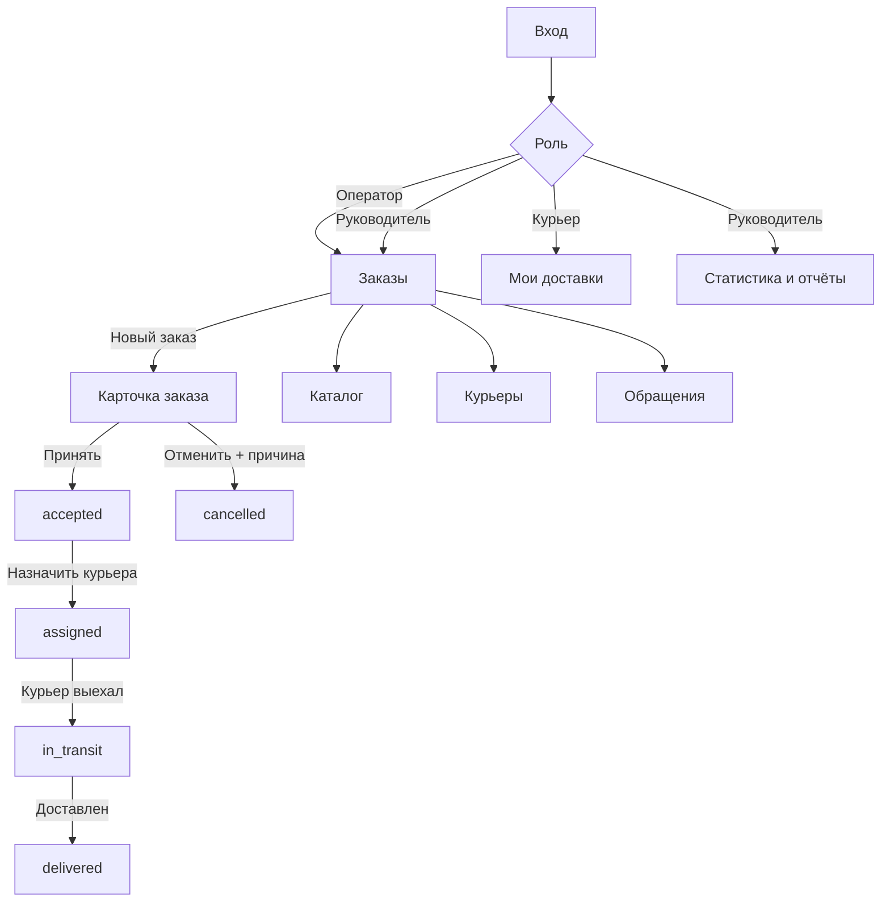

# Сценарий «Работа оператора в панели»

| | |
|---|---|
| Версия | 1.0 |
| Дата | 18.11.2026 |
| Автор | Ислам (студент 1, аналитик / тимлид) |
| Статус | Черновик, на согласовании с командой |
| Реализует | Нурдаулет |
| Связанные сценарии | `03-checkout.md`, `04-my-orders.md`, `05-notifications.md`, `06-faq.md` |
| Требования | FR-ADM-01 … FR-ADM-10, FR-WEB-05, FR-NOT-01, NFR-06, NFR-09, NFR-10 |
| Затрагивает главу | Глава 1 (TO-BE), Глава 2 (панель, RBAC), глава 3 (тесты) |

---

## 1. Назначение и границы

**Назначение.** Описать рабочий день оператора в панели: как он видит новый заказ, принимает его, назначает курьера, доводит до «Доставлен» или отменяет, правит каталог, отвечает на обращения и смотрит статистику. Панель — вторая половина системы: без неё заказ из бота и сайта некуда деть.

**Входит в сценарий:**

- вход и выход, разграничение ролей (оператор, курьер, руководитель);
- список заказов с фильтрами и поиском;
- карточка заказа и смена статусов по правилам;
- назначение курьера;
- отмена заказа с причиной;
- управление каталогом (категории, товары, цены, доступность);
- управление курьерами;
- обращения клиентов из «Помощи»;
- статистика для руководителя;
- журнал действий и индикатор доставки уведомлений.

**Не входит (отдельные сценарии):**

- создание заказа клиентом — `03-checkout.md`;
- тексты уведомлений клиенту — `05-notifications.md`;
- диалог клиента с FAQ и AI — `06-faq.md`;
- бухгалтерия, склад, интеграции — вне MVP;
- мобильное приложение панели — вне MVP (но интерфейс адаптивный, NFR-10).

**Главное правило.** Панель не пишет в `Order` напрямую из представления. Любая смена статуса идёт через `OrderService.change_status()`, который проверяет переход, пишет историю и запускает уведомление (`05-notifications.md`, п. 3.2).

---

## 2. Роли и права

| Действие | Оператор | Курьер | Руководитель / админ |
|---|---|---|---|
| Видеть все заказы | да | нет, только свои назначенные | да |
| Видеть новые заказы и звук | да | нет | да |
| Принять заказ (`new → accepted`) | да | нет | да |
| Назначить курьера | да | нет | да |
| `assigned → in_transit` | да | да, свой заказ | да |
| `in_transit → delivered` | да | да, свой заказ | да |
| Отменить заказ | да, до `in_transit` | нет | да |
| Смотреть состав и сумму | да | да, по своему заказу | да |
| Менять каталог | да | нет | да |
| Управлять курьерами | да | нет | да |
| Отвечать на обращения | да | нет | да |
| Смотреть статистику | нет | нет | да |
| Управлять пользователями и ролями | нет | нет | да |
| Выгружать отчёты | нет | нет | да (C) |

**Правила доступа:**

1. Права проверяются на сервере в каждом представлении, а не только скрытием кнопок в шаблоне.
2. Курьер не может открыть чужой заказ по прямой ссылке — 403.
3. Оператор не может повысить себе роль.
4. Руководитель не редактирует заказы, кроме отмены? Решение: **может всё, что оператор**, иначе в отпуске оператора работа встанет.
5. Владелец бизнеса получает только отчёты (роль `viewer`, S).

---

## 3. Принятые решения

| № | Вопрос | Решение в MVP | Обоснование |
|---|---|---|---|
| 1 | Где живёт панель | Django: кастомные страницы для заказов, обращений и статистики; стандартная админка для каталога, курьеров и пользователей | Быстро, знакомо команде, даёт готовую авторизацию и права |
| 2 | Авторизация | Логин и пароль Django, сессия 8 часов, выход по кнопке | NFR-06; 2FA — после MVP |
| 3 | Пароли | Хеш Django, минимум 10 символов, смена при первом входе для новых пользователей (S) | NFR-05 |
| 4 | Обновление списка | Опрос `/panel/orders/new-count` раз в 5 секунд + звук и заголовок вкладки | WebSocket — красивее, но для 1–3 операторов избыточен |
| 5 | Смена статуса | Только через `OrderService`; UI показывает лишь допустимые кнопки | Одно место проверки, невозможно обойти правила из браузера |
| 6 | Одновременная работа двух операторов | Условное обновление `WHERE status = ожидаемый`; при конфликте — «Заказ уже изменился, обновите страницу» | Два оператора не должны перезаписать друг друга |
| 7 | Назначение курьера | Только активные курьеры; показывается число активных заказов у каждого | Оператор видит, кто свободнее |
| 8 | Отмена | Обязательна причина из списка; свободный комментарий для `other` | Причина нужна клиенту и статистике |
| 9 | `new → accepted` | Одна кнопка «Принять», без подтверждения | Массовое рутинное действие |
| 10 | `delivered` | Кнопка с подтверждением «Заказ действительно доставлен?» | Статус закрывает заказ и попадает в выручку |
| 11 | Удаление товара | Не удаляем физически: `is_available = False` | История заказов ссылается на товар (требования, раздел 6) |
| 12 | Цена товара | Меняется только для будущих заказов; в заказе — `OrderItem.price` | Иначе история «поедет» |
| 13 | Статистика | Выручка — только `delivered`; период — по дате доставки | Иначе отменённые и текущие заказы завышают выручку |
| 14 | Источник заказа | Колонка «Источник»: 🛍 сайт / 🤖 бот | FR-WEB-05 |
| 15 | Журнал действий | `OrderStatusHistory` + `AuditLog` для каталога и ролей | NFR-09, FR-ADM-09 |
| 16 | Удаление заказов | Запрещено | Отчётность и споры |
| 17 | Работа с телефона | Адаптивная вёрстка, ключевые действия доступны с 360 px | NFR-10 |

---

## 4. Общая схема



**Жизненный цикл заказа и кто двигает:**

| Переход | Кто | Что происходит |
|---|---|---|
| `— → new` | Бот или сайт | Заказ появляется в панели, звук у оператора |
| `new → accepted` | Оператор | Уведомление клиенту «Оператор подтвердил» |
| `accepted → assigned` | Оператор | Уведомление «Курьер назначен» |
| `assigned → in_transit` | Курьер или оператор | Уведомление «Курьер выехал» |
| `in_transit → delivered` | Курьер или оператор | Уведомление «Доставлен», заказ уходит в выручку |
| `new/accepted/assigned → cancelled` | Оператор (или клиент, только из `new`) | Уведомление с причиной |
| `in_transit → cancelled` | Запрещено | Курьер уже в пути; вопрос решается через поддержку |

---

## 5. Детальные шаги

### 5.1. Вход и главный экран

| Шаг | Что видит пользователь | Поведение |
|---|---|---|
| Открывает `/panel/` | Форма входа | Логин, пароль, «Запомнить меня» (S) |
| Верные данные | «Заказы» с счётчиками | Новые, в работе, доставлены сегодня |
| Неверные данные | `Неверный логин или пароль.` | Без подсказки, что именно неверно |
| 5 ошибок за 15 минут | `Слишком много попыток. Попробуйте через 15 минут.` | Блокировка по IP + логину (S) |
| Сессия истекла | Редирект на вход | После входа — возврат на ту же страницу |
| Нет прав на раздел | 403 + «Нет доступа к разделу» | Ссылка на «Заказы» |

Индикатор новых заказов:

- число новых заказов в заголовке вкладки: `(2) Nurlight — панель`;
- короткий звук при появлении заказа (можно отключить);
- всплывающее уведомление в углу: `Новый заказ №000043 на 5 800 ₸ — из бота`;
- опрос раз в 5 секунд; при ошибке сети — жёлтая полоса «Нет связи с сервером», повтор автоматически.

### 5.2. Список заказов

| Элемент | Содержимое |
|---|---|
| Колонки | №, время, клиент, телефон, сумма, источник, статус, курьер |
| Фильтры | Статус (все / новые / в работе / доставлены / отменены), дата (сегодня / 7 дней / период), источник (бот / сайт), курьер |
| Поиск | По номеру заказа и телефону |
| Сортировка | По умолчанию новые сверху; можно по сумме и времени |
| Пагинация | 25 заказов на страницу |
| Подсветка | Новые — жирным и цветной полосой; просроченные (new > 5 минут) — красным |

Правила:

- фильтры сохраняются в URL, чтобы ссылку можно было передать коллеге;
- телефон показывается полностью: оператору он нужен для звонка;
- источник — иконка и подпись, чтобы не путать с курьером;
- пустой список: «Заказов с такими фильтрами нет» + «Сбросить фильтры».

### 5.3. Карточка заказа

**Содержимое:**

```
Заказ №000042 · Новый · из бота
Создан: 18.11.2026, 14:20

Клиент: Айгуль С. · +7 777 123 45 67
Адрес: Алматы, ул. Абая, 15, кв. 42
Комментарий: Позвонить за 10 минут

Состав:
Маргарита        2 × 2 900 = 5 800 ₸
Кола 0,5         1 × 450   = 450 ₸
Товары: 6 250 ₸ · Доставка: бесплатно · Итого: 6 250 ₸

История:
14:20 создан (бот)
14:22 принят — оператор Нурдаулет
14:35 передан курьеру — Аслан
14:40 в пути — курьер Аслан

Уведомления: принят — доставлено; передан — не доставлено (бот заблокирован)
```

| Действие | Условие | Результат |
|---|---|---|
| «✅ Принять» | `new` | `accepted`, уведомление клиенту |
| «🛵 Назначить курьера» | `accepted` | Выбор курьера → `assigned`, уведомление |
| «🚚 Курьер выехал» | `assigned` | `in_transit`, уведомление |
| «✅ Доставлен» | `in_transit` | Подтверждение → `delivered`, уведомление |
| «❌ Отменить» | `new`, `accepted`, `assigned` | Причина → `cancelled`, уведомление |
| «Связаться с клиентом» | всегда | Ссылка `tel:` и переход в чат бота, если есть `telegram_id` |

После каждого действия страница не перезагружается целиком: карточка обновляется, статус и история меняются на месте.

### 5.4. Принятие заказа

| Шаг | Поведение |
|---|---|
| Оператор нажимает «✅ Принять» | `POST /panel/orders/<id>/accept` |
| Сервер | `change_status(order, accepted, actor=user, expected=current_status)` |
| Успех | Статус `accepted`, запись в истории, уведомление клиенту, плашка «Заказ принят» |
| Заказ уже не `new` | 409 + «Заказ уже изменился. Обновите страницу.» |
| Ошибка БД | «Не удалось изменить статус. Попробуйте ещё раз.» |

### 5.5. Назначение курьера

| Шаг | Что видит оператор |
|---|---|
| Нажимает «🛵 Назначить курьера» | Список активных курьеров: имя, телефон, число активных заказов |
| Выбирает курьера | `accepted → assigned`, курьер видит заказ у себя |
| Свободных курьеров нет | «Сейчас нет активных курьеров. Добавьте курьера или назначьте позже.» и ссылка «Курьеры» |
| Курьера деактивировали | Он пропадает из списка; уже назначенные заказы остаются за ним |

Правила:

- назначить можно только активного курьера;
- повторное назначение заменяет курьера, если статус ещё `assigned`, и пишется в историю;
- после `in_transit` сменить курьера нельзя без отмены — в MVP не поддерживается;
- курьер получает заказ в своём списке, отдельное Telegram-уведомление курьеру — S (в MVP панель).

### 5.6. «В пути» и «Доставлен»

| Шаг | Поведение |
|---|---|
| Курьер открывает «Мои доставки» | Только заказы, где он назначен, со статусом `assigned` или `in_transit` |
| «🚚 Выехал» | `assigned → in_transit`, адрес и телефон доступны, уведомление клиенту |
| «✅ Доставлен» | Подтверждение → `in_transit → delivered`, время доставки фиксируется |
| Курьер пытается отменить | Кнопки нет; «Отмену делает оператор» |
| Оператор меняет статус за курьера | Разрешено, записывается кто именно изменил |

### 5.7. Отмена заказа

| Шаг | Поведение |
|---|---|
| «❌ Отменить» | Форма: причина (обязательно), комментарий (для «Другое») |
| Причины | «Клиент попросил», «Закончились продукты», «Нет курьера», «Ошибка в адресе», «Другое» |
| Подтверждение | «Отменить заказ №000042? Клиент получит уведомление.» |
| Успех | `cancelled`, причина и автор в истории, уведомление клиенту |
| Заказ уже `in_transit` | Кнопки отмены нет; подсказка «Курьер в пути — решите вопрос через поддержку» |
| Заказ `delivered` | Отмена запрещена |

Клиентская отмена (`04-my-orders.md`) приходит в панель как `cancelled` с причиной «клиент попросил» и автором «клиент». Оператор видит её в общем списке и в истории.

### 5.8. Каталог

| Раздел | Действия | Валидация |
|---|---|---|
| Категории | Создать, переименовать, изменить порядок, скрыть | Название 2–100 символов, уникальное |
| Товары | Создать, изменить, скрыть/показать | Название 2–100, цена > 0, категория обязательна, описание ≤ 1000 |
| Цена | Изменение цены | Применяется к новым заказам; существующие не меняются |
| Доступность | Переключатель `is_available` | Скрытый товар исчезает из бота и сереет на сайте |
| Удаление | Только скрытие | Если товара нет ни в одном заказе — допускается физическое удаление (S) |

После сохранения товара сбрасывается кэш меню сайта (30 секунд, см. `01-catalog.md`, п. 3.3). В журнал пишется: кто, когда, что изменил, старое и новое значение.

### 5.9. Курьеры

| Действие | Правила |
|---|---|
| Добавить | Имя, телефон в формате `+7XXXXXXXXXX`, активен по умолчанию |
| Деактивировать | Уже назначенные заказы остаются; новые назначить нельзя |
| Удалить | Запрещено, если есть заказы; только деактивация |
| Список | Имя, телефон, активность, число активных заказов, число доставок за 30 дней |

### 5.10. Обращения клиентов

| Шаг | Что видит оператор |
|---|---|
| Открывает «Обращения» | Список: номер, клиент, текст, последний заказ, источник, время ожидания |
| Новое обращение | Подсветка, звук, счётчик в меню; через 15 минут — красным |
| «Взять в работу» | `status = taken`, `taken_by = оператор`, другие операторы видят, кто взял |
| Ответ | Поле до 1000 символов, «Отправить» → `answered`, клиенту уходит сообщение в бот |
| Клиент заблокировал бота | Ответ сохраняется, плашка «не доставлено», оператор может позвонить |
| Закрыть | `closed`, повторный ответ невозможен |

Обращения — из `06-faq.md`, шаг 6. SLA: 15 минут в рабочее время; вне часов — утром.

### 5.11. Статистика и отчёты

| Показатель | Формула | Примечание |
|---|---|---|
| Выручка | Σ `Order.total` заказов `delivered` за период | Период — по `delivered_at` |
| Число заказов | Все созданные за период, с разбивкой по статусам | Отменённые видны отдельно |
| Средний чек | Выручка / число доставленных | — |
| Среднее время доставки | avg(`delivered_at` − `created_at`) по доставленным | В минутах |
| Доля отмен | отменённые / все созданные | — |
| Источник | число и сумма по `bot` и `site` | FR-WEB-05 |
| Топ-5 товаров | по количеству и по сумме | За период |
| Загрузка курьеров | доставок на курьера за период | — |

| Элемент | Поведение |
|---|---|
| Период | Сегодня / 7 дней / 30 дней / произвольный |
| График | Выручка по дням (линейный), заказы по статусам (столбцы) |
| Экспорт | CSV за период (C) |
| Ошибка данных | «Не удалось построить отчёт. Попробуйте ещё раз.» |

Руководитель видит статистику, оператор — нет (матрица в разделе 2). Цифры на дашборде и в отчёте должны считаться одной функцией, иначе они разойдутся.

### 5.12. Пользователи и роли

| Действие | Правила |
|---|---|
| Создать пользователя | Логин, имя, роль, временный пароль |
| Сменить роль | Только руководитель; себе — нельзя |
| Деактивировать | Сессия завершается, история остаётся |
| Сбросить пароль | Одноразовая ссылка или временный пароль (S) |

---

## 6. Тексты и сообщения интерфейса

| Код | Текст |
|---|---|
| `LOGIN_FAILED` | Неверный логин или пароль. |
| `LOGIN_LOCKED` | Слишком много попыток. Попробуйте через 15 минут. |
| `FORBIDDEN` | Нет доступа к разделу. |
| `ORDER_CHANGED` | Заказ уже изменился. Обновите страницу. |
| `STATUS_OK` | Статус изменён: {статус}. |
| `STATUS_FAILED` | Не удалось изменить статус. Попробуйте ещё раз. |
| `CANCEL_REASON_REQUIRED` | Укажите причину отмены. |
| `COURIER_REQUIRED` | Выберите курьера. |
| `NO_COURIERS` | Сейчас нет активных курьеров. Добавьте курьера или назначьте позже. |
| `PRODUCT_SAVED` | Товар сохранён. Изменения уже видны клиентам. |
| `PRICE_INVALID` | Цена должна быть больше нуля. |
| `NOTIFY_FAILED` | Уведомление клиенту не доставлено: {причина}. |
| `SUPPORT_TAKEN` | Обращение взято в работу. |
| `SUPPORT_SENT` | Ответ отправлен клиенту. |
| `SUPPORT_NOT_DELIVERED` | Клиент заблокировал бота — ответ не доставлен, позвоните. |

**Подтверждения:**

- «Отменить заказ №{номер}? Клиент получит уведомление.»
- «Заказ №{номер} действительно доставлен?»
- «Скрыть товар «{название}»? Он исчезнет из бота и станет недоступен на сайте.»

---

## 7. Обработка исключительных ситуаций

| Ситуация | Когда возникает | Поведение |
|---|---|---|
| Два оператора меняют один заказ | Одновременные клики | Условное обновление, второй получает `ORDER_CHANGED`, данные перечитываются |
| Недопустимый переход | Кнопка устарела, статус уже другой | 409, кнопки перерисовываются по актуальному статусу |
| Заказ удалён | Между списком и карточкой | «Заказ не найден», возврат к списку |
| Нет курьеров | Назначение | `NO_COURIERS` + ссылка на раздел |
| Курьер деактивирован | Назначение | Пропадает из списка; назначенные заказы не ломаются |
| Удаление товара из заказа | Попытка удалить товар | Физическое удаление запрещено, только скрытие |
| Цена 0 или отрицательная | Сохранение товара | `PRICE_INVALID`, форма не сохраняется |
| Ошибка уведомления | Telegram недоступен | Статус меняется, `NOTIFY_FAILED`, заказ не откатывается |
| Сессия истекла | Долгая работа | Редирект на вход, возврат на страницу |
| Нет прав | Прямая ссылка | 403, без раскрытия данных |
| Потеря связи | Опрос не проходит | Жёлтая полоса, повтор, данные не теряются |
| Много заказов | Пик | Пагинация 25, фильтры, индексы по статусу и дате |
| Отмена после `in_transit` | Оператор пытается | Кнопки нет, сервер тоже отклоняет |
| Обращение без ответа > 15 мин | Ожидание | Красная подсветка, счётчик в меню |

---

## 8. Требования к реализации

### 8.1. Файлы

| Файл | Содержимое |
|---|---|
| `admin_panel/delivery/views/orders.py` | Список, карточка, действия со статусами |
| `admin_panel/delivery/views/catalog.py` | Категории и товары |
| `admin_panel/delivery/views/couriers.py` | Курьеры |
| `admin_panel/support/views.py` | Обращения и ответы |
| `admin_panel/reports/views.py` | Статистика и CSV |
| `admin_panel/delivery/services/orders.py` | `change_status()`, `assign_courier()`, `cancel_order()` |
| `admin_panel/accounts/models.py` | Роль пользователя, права |
| `admin_panel/delivery/models.py` | `OrderStatusHistory`, `AuditLog` |
| `admin_panel/templates/**` | Шаблоны, адаптивная вёрстка |

### 8.2. Маршруты (примерные)

| Метод | URL | Назначение |
|---|---|---|
| `GET` | `/panel/` | Список заказов |
| `GET` | `/panel/orders/<id>/` | Карточка |
| `POST` | `/panel/orders/<id>/accept/` | Принять |
| `POST` | `/panel/orders/<id>/assign/` | Назначить курьера |
| `POST` | `/panel/orders/<id>/status/` | «В пути» / «Доставлен» |
| `POST` | `/panel/orders/<id>/cancel/` | Отмена с причиной |
| `GET` | `/panel/orders/new-count/` | Счётчик для опроса |
| `GET/POST` | `/panel/catalog/...` | Каталог |
| `GET/POST` | `/panel/support/...` | Обращения |
| `GET` | `/panel/reports/` | Статистика |

### 8.3. Требования к коду

1. Все изменяющие действия — только `POST` с CSRF-токеном.
2. Каждое представление проверяет роль; декоратор `@role_required(...)`.
3. `change_status()` принимает ожидаемый статус и возвращает `409` при расхождении.
4. История пишется в той же транзакции, что и смена статуса.
5. Список заказов — `select_related("client", "courier")` + `prefetch_related("items__product")`, без N+1.
6. Индексы: `Order(status, created_at)`, `Order(courier, status)`, `SupportRequest(status, created_at)`.
7. Статистика — одна функция `build_report(period)` для дашборда и отчёта.
8. Суммы — `Decimal`, формат `format_money()`.
9. Секреты и пароли — только окружение (NFR-05).
10. Логи действий не содержат паролей и токенов.

### 8.4. Автотесты (NFR-11)

| Тест | Что проверяет |
|---|---|
| `test_accept_order` | `new → accepted`, история, уведомление вызвано |
| `test_invalid_transition` | `new → delivered` отклонён |
| `test_double_accept` | Второй запрос — 409, дубля нет |
| `test_courier_sees_only_own` | Курьер не видит чужой заказ |
| `test_operator_cannot_manage_users` | 403 |
| `test_cancel_requires_reason` | Без причины — ошибка |
| `test_price_change_keeps_order` | История заказа не изменилась |
| `test_report_revenue_only_delivered` | Отменённые не в выручке |
| `test_notification_called_once` | Один переход — одна запись журнала |

---

## 9. Критерии приёмки

| № | Проверка | Ожидаемый результат |
|---|---|---|
| 1 | Вход с верным паролем | Список заказов, счётчики |
| 2 | Неверный пароль 5 раз | Блокировка на 15 минут |
| 3 | Заказ из бота | Виден, источник «бот» |
| 4 | Заказ с сайта | Виден, источник «сайт» |
| 5 | Новый заказ при открытой панели | Появляется за 5 секунд, звук и счётчик |
| 6 | «Принять» | `accepted`, клиент получил уведомление |
| 7 | Назначить курьера | `assigned`, курьер видит заказ |
| 8 | Курьер «Выехал» | `in_transit`, уведомление |
| 9 | «Доставлен» с подтверждением | `delivered`, время зафиксировано |
| 10 | Отмена без причины | Ошибка, статус не изменился |
| 11 | Отмена в `in_transit` | Невозможна ни в UI, ни через сервер |
| 12 | Два оператора принимают один заказ | Один успех, второй — `ORDER_CHANGED` |
| 13 | Курьер открывает чужой заказ | 403 |
| 14 | Скрыть товар | Пропал из бота, серый на сайте |
| 15 | Поднять цену | В старых заказах цена прежняя |
| 16 | Удалить товар из заказа | Невозможно, только скрыть |
| 17 | Статистика за 7 дней | Выручка только по доставленным, среднее время корректно |
| 18 | Ответ на обращение | Клиент получил сообщение в бот |
| 19 | Клиент заблокировал бота | Ответ сохранён, плашка «не доставлено» |
| 20 | Панель на телефоне 360 px | Список и карточка читаемы, кнопки нажимаются |
| 21 | Прямая ссылка на раздел без прав | 403 |
| 22 | Отключить Telegram | Статусы меняются, панель работает |

---

## 10. Открытые вопросы

| № | Вопрос | Кого касается | Влияние |
|---|---|---|---|
| 1 | Разрешать ли руководителю менять заказы | Ислам, Нурдаулет | Сейчас да; иначе в отсутствие оператора работа встанет |
| 2 | Нужен ли WebSocket вместо опроса | Нурдаулет | Скорость и нагрузка; для MVP опрос достаточен |
| 3 | Нужен ли экспорт в Excel помимо CSV | Нурдаулет | Отчётность; CSV открывается в Excel |
| 4 | Нужен ли отдельный экран «Кухня» | все | Вне MVP; сейчас кухня не участвует в системе |
| 5 | Давать ли курьеру Telegram-уведомление о назначении | Нурадыл, Нурдаулет | Удобство против новой интеграции |
| 6 | Кто отвечает на обращения вне рабочих часов | Ислам, команда | Влияет на SLA и ожидания клиента |
